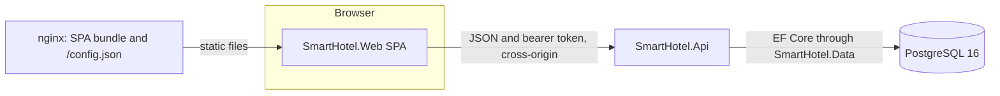

# SmartHotel

SmartHotel is a guest-facing hotel booking product. Guests register, log in, search hotels by city, dates and party size, compare room types with their nightly prices and availability, book a room, list their bookings and cancel them. Payment is simulated: a booking is confirmed on creation and no payment is taken online. Guests are the only user type.

The product is inspired by Microsoft's SmartHotel360 reference application. It is an original implementation: no code, names, data or assets were copied from it.

## Components

| Component | Path | Technology | Role |
|-----------|------|------------|------|
| Web app | `src/SmartHotel.Web` | Angular 17 single-page app, served by nginx | Screens, routing, forms, the in-memory session, and the loading indicator, empty-result messages, inline errors and login redirects in [What the web app shows](#what-the-web-app-shows) |
| API | `src/SmartHotel.Api` | ASP.NET Core 8 REST API | A modular monolith with Auth, Hotels, Bookings and Availability modules. The only component that reads or writes data. |
| Data layer | `src/SmartHotel.Data` | Entity Framework Core 8 with the Npgsql provider | Entities, mappings and constraints, the `InitialCreate` migration and the seed routine |
| Database | — | PostgreSQL 16 | Persistence and constraint enforcement, used only by the API |

## Architecture



The web container's nginx serves the SPA bundle and `/config.json`, which tells the SPA where the API is. It does not proxy the API. The SPA calls the API cross-origin, and the API's single CORS policy admits only the web app's origin, with the methods `GET`, `POST` and `DELETE`, the headers `Authorization` and `Content-Type`, and no credentials.

## Repository layout

```text
.
├── .config/
│   └── dotnet-tools.json        # dotnet-ef local tool
├── deploy/
│   ├── acceptance.env           # intentionally empty Compose env file
│   └── db/                      # db-entrypoint.sh: first-start secrets
├── src/
│   ├── SmartHotel.Api/          # REST API, Dockerfile, container entrypoint
│   ├── SmartHotel.Data/         # EF Core model, migration, seed
│   └── SmartHotel.Web/          # Angular workspace, e2e suite, nginx template
├── tests/
│   ├── SmartHotel.Api.IntegrationTests/
│   └── SmartHotel.Api.UnitTests/
├── .dockerignore
├── .editorconfig
├── .env.example
├── .gitignore
├── Directory.Build.props
├── Directory.Packages.props
├── docker-compose.yml
├── global.json
├── README.md
└── SmartHotel.sln
```

## Prerequisites

### Supported hosts

| Host | Architecture | Container runtime | Where the tools and tests run |
|------|--------------|-------------------|-------------------------------|
| Windows 11, a release still in Microsoft servicing | x86-64 | Docker Desktop with the WSL 2 backend | Natively on Windows, or inside an Ubuntu 22.04/24.04 or Debian 12/13 WSL 2 distribution with Docker Desktop's WSL integration |
| macOS 15, 26 or 27 | arm64 (Apple silicon); x86-64 (Intel) only on macOS 15 and 26, because macOS 27 does not run on Intel Macs | Docker Desktop | Natively |
| Ubuntu 22.04 or 24.04; Debian 12 or 13 | x86-64 or arm64 | Docker Engine | Natively |

These are the combinations that every prerequisite supports: Playwright 1.60.0's system requirements, the .NET 8 supported-OS list and a supported Linux-container runtime. Excluded:

- Windows Server, because Docker Desktop does not support it.
- Windows on Arm, because Docker Desktop supports it only as early access.
- macOS 14, because it falls outside both Docker Desktop's support window (the current and two previous major releases) and the .NET 8 list.
- Other Linux distributions, because Playwright 1.60.0 does not list them.

### Tools

- Docker Engine 28.0 or later, with Docker Compose v2.1.1 or later (`docker compose up --wait` needs 2.1.1). Docker Desktop releases that bundle those versions qualify. Engine 28.0 is also the first release that stops other hosts on the LAN from reaching ports published on `127.0.0.1`.
  - On a Linux host that runs firewalld, use Docker Engine 28.3.3 or later. Engines 28.2.0 through 28.3.2 do not restore that protection after firewalld reloads (CVE-2025-54388), so other hosts with a route to the Docker host could then reach ports published on `127.0.0.1`, including the passwordless `db-test`. `docker version --format '{{.Server.Version}}'` prints the engine version, and `systemctl is-active firewalld` prints `active` when firewalld runs. A firewalld host that must keep an earlier engine needs host firewall rules of its own that block forwarded traffic to the Docker networks, verified before the test fixture starts `db-test`; otherwise point `SMARTHOTEL_TEST_POSTGRES` at another server. Docker Desktop and rootless mode are not affected.
- .NET SDK 8.0.428 exactly. `global.json` pins it with roll-forward disabled, so `dotnet` commands in this repository fail unless that exact SDK is installed.
- Node.js 20.20.2 with npm, for the web workspace and its tests. The web image installs with npm 11.21.3, and hosts that want the same installer can use it too (`npm install -g npm@11.21.3`).
- Playwright's Chromium 148.0.7778.96, installed per machine with `npx playwright install chromium` (see [Web tests](#web-tests)).

### Line endings

Running the product needs no Git line-ending setting. The repository has no `.gitattributes`, so your Git settings decide the line endings of a checkout, and an LF or a CRLF checkout, Git for Windows' default included, starts with the same `docker compose up`:

- The `db` service bind-mounts `deploy/db/db-entrypoint.sh` and runs it as checked out. A copy with CRLF endings runs itself again with the carriage returns removed.
- The API and web image builds strip carriage returns from the shell scripts they place in their images.

C# files use CRLF, as the root `.editorconfig` requires. Committing new C# files needs a repository-local Git setting, described under [Quality gates](#quality-gates).

## Run the product

From the repository root:

```bash
docker compose up
```

Or start in the background and return once every service is healthy:

```bash
docker compose up -d --wait
```

The services start in order, with no manual step:

1. `db` (PostgreSQL 16) starts. On the first start its entrypoint wrapper creates the local secrets. It is healthy once it accepts TCP connections.
2. `api` applies the committed migration, seeds the catalogue and only then starts listening. It is healthy once `/api/health` answers, so a healthy `api` means a migrated and seeded database.
3. `web` starts once `api` is healthy.

The `api` container is limited to 1 GiB of memory, and the API's garbage collector adapts its heap to the load (DATAS) within that limit.

| Address | Serves |
|---------|--------|
| `http://localhost:4200` | The web app |
| `http://localhost:8080/api` | The API |
| `http://localhost:8080/api/health` | The readiness probe: `200` with the plain-text body `Healthy` |

Every published port is bound to `127.0.0.1`, so nothing listens on other host interfaces. No database port is published, and the API is the only service that uses the database.

To use other host ports, set `SMARTHOTEL_API_PORT` (default `8080`) and `SMARTHOTEL_WEB_PORT` (default `4200`) in the shell or in `.env`. Compose derives the API's CORS origin (`Cors__AllowedOrigin`) and the SPA's API base URL (`API_BASE_URL`) from the same two variables, so the web app and CORS always agree:

```bash
SMARTHOTEL_API_PORT=9080 SMARTHOTEL_WEB_PORT=5200 docker compose up -d --wait
```

Each port must be one port number from `1` to `65535`, written in decimal without leading zeros. Compose itself also accepts `0` (a random port), ranges such as `14200-14201` and leading zeros such as `04200`, but none of them gives the CORS origin and the web app's API address one fixed port, written as browsers write it. The `api` container therefore exits at start with a message that names the variable, shown by `docker compose logs api`, and `docker compose up --wait` fails. Port `80` works as browsers write it: `SMARTHOTEL_WEB_PORT=80` gives the CORS origin `http://localhost`, and `SMARTHOTEL_API_PORT=80` makes the web app call `http://localhost/api`.

### Seed data

On the first start the API seeds five hotels in three cities:

| Hotel | City |
|-------|------|
| SmartHotel Seattle Downtown | Seattle |
| SmartHotel Seattle Waterfront | Seattle |
| SmartHotel New York Midtown | New York |
| SmartHotel New York Brooklyn | New York |
| SmartHotel Chicago Loop | Chicago |

- Every hotel has four room types: Standard and Deluxe for up to 2 guests, Family and Suite for up to 4.
- Each room type has 10 rooms, numbered 101–110, 201–210, 301–310 and 401–410. That makes 20 room types and 200 rooms in total.
- The first hotel's nightly prices are 129.00, 169.00, 219.00 and 329.00 USD, and each later hotel in the list charges 10.00 USD more per room type than the one before.
- Seeding runs only while no hotel exists, so a second start inserts nothing.

### Secrets

No secret lives in source or in committed configuration. The local stack has two secrets, the database password and the JWT signing key.

- On the first start the `db` service's wrapper, `deploy/db/db-entrypoint.sh`, writes each missing secret into the `secrets` volume as `/run/smarthotel-secrets/db_password` and `/run/smarthotel-secrets/jwt_signing_key`, with mode `0444`. A generated secret is 32 random bytes written as 64 hex characters.
- Only `db` and `api` mount the volume, and `api` mounts it read-only. Each container's entrypoint passes the secrets to its process only as environment variables: `POSTGRES_PASSWORD` for PostgreSQL, and `DB_PASSWORD` and `Jwt__SigningKey` for the API.

To choose the values yourself, set the optional first-start overrides `SMARTHOTEL_DB_PASSWORD` and `SMARTHOTEL_JWT_SIGNING_KEY` in the shell, or in a `.env` file copied from [`.env.example`](.env.example). Copying it is optional, and `.env` is git-ignored. A blank value is generated.

An override must have this format:

- A single line made only of the letters `A-Z` and `a-z`, the digits `0-9` and the characters `. _ ~ + / = -`. These need no quoting in a connection string, in PostgreSQL's initialization or in a `.env` file, which Compose reads without a shell. In a shell, put the value in single quotes, as in `export SMARTHOTEL_DB_PASSWORD='<your password>'`: unquoted, a leading `~` can expand to a home directory, and in zsh a leading `=` to a command's path, before the wrapper checks the value, so the stored secret can silently differ from what you typed.
- `SMARTHOTEL_DB_PASSWORD`: 16–128 characters.
- `SMARTHOTEL_JWT_SIGNING_KEY`: 32–256 characters.

On a first start the wrapper checks every override that is set before it writes anything. An invalid override makes `db` exit with a message that names the variable, never its value, so `db` never becomes healthy and `docker compose up --wait` fails.

### Signing in and out

A bearer token is valid for 60 minutes. The web app keeps it only in memory, never in `localStorage`, `sessionStorage` or a cookie, so reloading the page or opening a new tab signs the guest out. Logging out clears that in-memory session and returns to the search page. There is no logout endpoint, so a discarded token stays valid on the server until it expires.

### What the web app shows

- Before the app starts, the page shows "Loading SmartHotel…" while it fetches `/config.json`. The "Loading…" indicator does not cover that request, and the app replaces the message once it starts. If the request fails, answers with an error status or takes longer than 10 seconds, if the configuration is not valid JSON or has an API base URL the app does not accept (see [HTTPS outside local development](#https-outside-local-development)), or if the app fails to start, the page shows "SmartHotel could not start: its configuration is unavailable. Reload to try again." in place of the app.
- A "Loading…" indicator shows between the nav bar and the page while any request to the API is in flight. "Search", "Log in", "Create account", "Book" and "Cancel" stay disabled while their own request is pending.
- A search that finds nothing shows "No hotels with available rooms in {city} for these dates.", and My bookings with none shows "You have no bookings yet."
- A `400`, `409` or `401` from the API shows inline on the page that sent the request, with the problem's title, its detail and any field errors, except the `401` on entering My bookings, which redirects as described below. The login page's `401` reads "Email or password is incorrect." and the register page's `409` reads "An account with this email already exists." When the API cannot be reached, the page shows "The service is unreachable."
- My bookings is the only protected page. Opening it without a live session, because the guest is signed out, the token has expired or the page was reloaded, goes to `/login?returnUrl=%2Fbookings`, and logging in returns to My bookings. "Book" while signed out also goes to the login page, and logging in returns to the same hotel and stay.
- The API can reject a token before it expires. A `401` from a bookings request then signs the guest out, and the nav bar shows "Log in". On entering My bookings, the app goes to `/login?returnUrl=%2Fbookings&reason=session-expired`, which shows "Your session has expired. Log in again." After "Book" on a hotel or "Cancel" on My bookings, the guest stays on the page and sees the `401` inline with a "Log in again" link.

## Reset and override semantics

The supported reset removes the database and the secrets together:

```bash
docker compose down -v
```

- Secret files are written only when absent, so `SMARTHOTEL_DB_PASSWORD` and `SMARTHOTEL_JWT_SIGNING_KEY` are read only while a secret file is missing, normally on a first start. Once both files exist, later starts ignore them and log a notice.
- PostgreSQL applies its password only when it initializes an empty data directory, so a restart never changes the database role's password.
- A changed override therefore takes effect only after `docker compose down -v`.
- Removing only the `db-data` volume keeps the secrets consistent, because PostgreSQL re-initializes it with the retained password. It also deletes every guest account and booking: the next start restores only the seeded catalogue of hotels, room types and rooms.
- Do not remove only the `secrets` volume while `db-data` survives. The next start generates a password that no longer matches the database role, and the API cannot connect. Recover with `docker compose down -v`.

## API overview

All endpoints are under `/api`. This table is a summary, not the full contract.

| Method and path | Auth | Purpose | Success |
|-----------------|------|---------|---------|
| `POST /api/auth/register` | None | Register a guest with `email`, `password` (8–128 characters) and `fullName` | `201` with the new guest's id, such as `{ "guestId": 42 }` |
| `POST /api/auth/login` | None | Exchange an email and password for a bearer token | `200` with `token` and `expiresAt` |
| `GET /api/hotels` | None | Search by `city`, `checkIn`, `checkOut` and `guests` (optional, default 1). A hotel is listed only when at least one of its room types that fits the party (`maxGuests` ≥ `guests`) has a free room for the dates. Its `lowestNightlyPrice` is the lowest nightly price among those fitting, free room types. Results are ordered by that price, then by name. | `200`; `[]` when none qualify, including an unknown city |
| `GET /api/hotels/{id}` | None | Hotel detail for `checkIn`, `checkOut` and `guests` (optional, default 1): room types, nightly prices, available rooms per type and the stay total. Each type's `availableRooms` counts its rooms with no overlapping `Confirmed` booking for the dates, whatever `guests` is: a count of physical inventory. The web app disables "Book" when `guests` exceeds a type's `maxGuests`. | `200` |
| `POST /api/bookings` | Bearer | Book a room type with `hotelId`, `roomTypeId`, `checkIn`, `checkOut` and `guests`. The server assigns the room and computes the total. | `201` with the booking |
| `GET /api/bookings` | Bearer | The caller's own bookings, newest first | `200`; `[]` when none |
| `DELETE /api/bookings/{id}` | Bearer | Cancel one of the caller's own bookings | `204` |
| `GET /api/health` | None | Readiness probe | `200`, `text/plain` body `Healthy` |

Conventions:

- Request and response bodies are JSON with camelCase property names, with two success exceptions: `DELETE /api/bookings/{id}` answers `204` with no body, and `GET /api/health` answers `text/plain` `Healthy`. Enums are strings, such as `Confirmed` and `Cancelled`. Timestamps are UTC ISO 8601 with a `Z` suffix, and money is a number in USD with two decimals.
- Dates are exactly `yyyy-MM-dd`. Other forms, such as `2026-1-5` or `12/07/2026`, return `400`.
- Every error response has `Content-Type: application/problem+json`, whatever the `Accept` header says. Whenever HTTP permits a body, the body carries `type`, `title`, `status`, `detail` and `traceId`, and a `400` also carries `errors`. An error response to a `HEAD` request keeps that `Content-Type` and has no body.
- That includes requests the server rejects before the API sees them, such as an over-long request line (`414`) or oversized headers (`431`), which is why the API serves [HTTP/1.1](#outside-local-development).
- A stay is 1–30 nights, and check-in cannot be earlier than today's UTC date.
- The check-out day is not occupied: a stay that ends on the 12th and one that starts on the 12th can share a room.
- A bearer token from `POST /api/auth/login` is valid for 60 minutes. Send it as `Authorization: Bearer <token>`.
- Booking creation is atomic. Concurrent requests for the last free room produce one `201` and a `409` for every other request, never a double booking.
- The main error statuses are `400` for invalid input, `401` for a missing or rejected token or wrong credentials, `403` for another guest's booking, `404` for an unknown hotel, room type or booking, `409` for an email already registered, no free room, or a booking already cancelled or whose check-in date has passed, and `415` for a register, login or booking-creation request without a JSON media type in a supported charset.
- Those three endpoints decide between `415` and `400` by the request's media type first, then by its content. A `Content-Type` that is absent, is not a JSON media type (`application/json`, `text/json` or an `application/*+json` type), or names a `charset` other than UTF-8 or little-endian UTF-16 (such as `iso-8859-1`, `us-ascii` or `utf-16be`) returns `415` whatever the body, a bodyless request included. With a JSON media type read as UTF-8 (the default when no `charset` is given) or as little-endian UTF-16 (`charset=utf-16` or `utf-16le`), a body that is empty or just `null`, is malformed JSON, is not a JSON object, or gives a field a value of the wrong JSON type, such as a number for `email`, returns `400` with the JSON path of the failure in `errors`, such as `$` or `$.email`. A member set to `null` or left out of the object binds as `null` and goes on to the endpoint's own checks, so login answers `401`, while registration and booking creation answer `400` with their field errors. On booking creation, a missing or rejected token returns `401` before the body is considered.

## Testing

### API tests

From the repository root:

```bash
dotnet test
```

This runs `SmartHotel.sln`: the unit tests in `tests/SmartHotel.Api.UnitTests` and the integration tests in `tests/SmartHotel.Api.IntegrationTests`, which drive the real API pipeline in-process against a real PostgreSQL 16 server.

- By default the test fixture starts the `db-test` Compose service itself, in its own Compose project `smarthotel-test` with `--profile test`. The service is published on `127.0.0.1:55432`, accepts passwordless connections (trust authentication), sits alone on its own `testdb` network and keeps its data on tmpfs; its server log, like `db`'s, leaves out constraint DETAIL, the failing statement of any error below PANIC, and bind parameters. Docker must therefore be running. The service's loopback-only publishing relies on the Docker Engine requirement under [Tools](#tools): 28.0 or later, and 28.3.3 or later on a Linux host that runs firewalld. The fixture leaves the service running for the next run. It starts `db-test` only on this machine's Docker daemon: it first asks the docker CLI which daemon it selects (`DOCKER_HOST` when set, else `DOCKER_CONTEXT`, else the current context) and passes that endpoint to Compose as `--host`, and it refuses anything but a local unix socket or a local Windows named pipe, such as a TCP or SSH endpoint, with a message that names the kind of endpoint but not its value. To fix that, unset `DOCKER_HOST` or `DOCKER_CONTEXT`, switch with `docker context use` to a local context such as `default` or Docker Desktop's, or set `SMARTHOTEL_TEST_POSTGRES`. A unix socket or named pipe on this machine is trusted as this machine's Docker daemon (Docker Engine's, rootless Docker's or Docker Desktop's, whose published `127.0.0.1` ports reach this host); the fixture cannot tell whether such a socket forwards to another machine, as an SSH-forwarded socket does, so never point `DOCKER_HOST` or a context at one.
- <a name="alternate-test-server"></a>To use another server instead, set `SMARTHOTEL_TEST_POSTGRES` to its connection string. That server must meet every prerequisite below:
  - **Selection.** A blank or whitespace-only value counts as unset. Unset, the fixture starts `db-test` and connects with `Host=127.0.0.1;Port=55432;Username=postgres` and `SSL Mode=Disable`, because `db-test` offers no TLS. Set, the value selects the server and no Compose call is made.
  - **Connection string.** A valid Npgsql connection string that sets `Host`, for a PostgreSQL 16 server.
  - **Maintenance database.** The server user connects to the `postgres` database, where it creates and drops each test class's login role and database.
  - **Privileges.** The server user is a superuser, or has `CREATEDB` and `CREATEROLE`.
  - **Statement-text logging.** The fixture sets a test role's password only once no server log setting can record that statement's text. It turns each setting the server user may change off for that one statement's transaction, never changes the server's own settings, and otherwise refuses to set the password with a message that names the settings to cover. Each of these eight checks therefore needs the `SET` privilege on its setting, or the server value shown, which keeps statement text out of the log; a superuser passes all eight. PostgreSQL 16's defaults leave only `log_min_error_statement` to cover, for example with `GRANT SET ON PARAMETER log_min_error_statement TO <server user>`.
    - `log_statement` `none`
    - `log_min_error_statement` `panic`
    - `log_min_duration_statement` `-1`
    - `log_min_duration_sample` `-1` or `log_statement_sample_rate` `0`, one check that `SET` on either setting also passes
    - `log_transaction_sample_rate` `0`
    - `debug_print_parse`, `debug_print_rewritten` and `debug_print_plan` `off`, three checks that always pass: any user may change these settings, so the fixture always turns them off for that one transaction
  - **Connection slots.** `ConcurrentBookingTests` needs 22 sessions of its class's login role open at once: 20 booking requests, a lock holder and an observer. Its check takes `max_connections` less `superuser_reserved_connections` and `reserved_connections`, capped by any connection limit on the role or the database, and fails below 22. That many slots must also be free while it runs, beside the sessions of the other test classes running in parallel.
  - **Transport.** A loopback host (`localhost`, `127.0.0.0/8` or `::1`) or a Unix-domain socket may use any `SSL Mode`; use `SSL Mode=Disable` only for an isolated loopback test server without TLS. Every other host, including each host of a multi-host `Host` list, requires `SSL Mode=VerifyFull`, with `Root Certificate` naming the certificate authority when the system does not trust it. The fixture refuses any other string before it connects.
  - **Ambient client certificate.** Test connections name no client certificate. Whenever `SSL Mode` is not `Disable`, which is always the case for a remote server, the fixture refuses to start, before it connects to the server or creates any test database, if Npgsql could present an ambient one: when `PGSSLCERT` is set, even to an empty value, or else when `postgresql.crt` exists in `~/.postgresql` (`%APPDATA%\postgresql` on Windows). Unset `PGSSLCERT` and move that file aside for the test run. Only a loopback or Unix-domain socket server may avoid the certificate with `SSL Mode=Disable` instead.
  - **Carried settings.** Each test class's connections are pooled without multiplexing at Npgsql's default pool limits, whatever pool and multiplexing settings the string carries; its host, port, timeouts, `SSL Mode` and `Root Certificate` carry over.
  - **Secrecy.** A connection string can carry a password, so the fixture never prints the value, and its errors name the variable only.
- Each test class creates its own `smarthotel_it_<guid>` database and its own login role of the same name, with a random password, which owns the database. The class connects only as that role, never with the server's credentials, and drops both afterwards.

Focused runs:

```bash
# Twenty concurrent bookings for the last free room
dotnet test --filter "FullyQualifiedName~ConcurrentBookingTests"
# Every integration test, including the error matrix
dotnet test --filter "FullyQualifiedName~SmartHotel.Api.IntegrationTests"
# Missing tokens, and cancelling another guest's booking
dotnet test --filter "FullyQualifiedName~ListBookingsTests|FullyQualifiedName~CancelBookingTests"
```

To stop the test database, see [Removing the test stacks](#removing-the-test-stacks).

### Web tests

One-time setup:

```bash
cd src/SmartHotel.Web
npm ci
npx playwright install chromium
```

On Linux, install Chromium with its system dependencies instead: `npx playwright install --with-deps chromium`.

`ng test` uses the pinned Angular CLI in `node_modules/.bin`. Put that directory on `PATH` for the shell session, from `src/SmartHotel.Web`, then run `ng test`. In a POSIX shell:

```bash
export PATH="$PWD/node_modules/.bin:$PATH"
ng test
```

In PowerShell:

```powershell
$env:Path = "$PWD\node_modules\.bin;$env:Path"
ng test
```

`npx ng test` is equivalent. No globally installed Angular CLI is assumed, and `npm test` is not supported, because `package.json` defines no `test` script.

`ng test` runs Playwright Test, the web app's only test framework, through the in-repo Angular builder in `tools/playwright-builder`. Karma and Jasmine are not used. The suite runs in Chromium, one test at a time, with no retries. Docker must be running: a fresh run, the default, builds its stack with Compose, and in either mode the production Content-Security-Policy tests in `e2e/stack.spec.ts` render the web image's nginx template with `docker run`. In [reuse mode](#reuse-mode) setup itself makes no Docker call and builds, resets or removes no stack.

#### Acceptance stack

Unless reuse mode is on, every `ng test` or `npx playwright test` run first builds a dedicated acceptance stack:

- It removes and rebuilds the Compose project `smarthotel-acceptance`: `down -v --remove-orphans`, then `up -d --build --force-recreate --wait`. The images are built from the current sources, and the volumes and secrets are fresh.
- It publishes the API on host port 18080 and the web app on host port 14200. The tests target `http://localhost:14200` and `http://localhost:18080/api`.
- Once both answer, setup requires the web app's `http://localhost:14200/config.json` to name `http://localhost:18080/api` as its API, in the canonical form the SPA uses, so the browser tests and the tests' direct API requests reach the same stack and database. A missing, invalid or different API base URL fails the run with a message that names the expected API and never prints the served value.
- Every Compose call is `docker --host <endpoint> compose -p smarthotel-acceptance -f <root>/docker-compose.yml --project-directory <root> --env-file <root>/deploy/acceptance.env …`, where `<root>` is the repository root and `<endpoint>` is the local Docker daemon described in the next bullet. `-f` names the repository's Compose file, which also keeps a `docker-compose.override.yml` out; `--project-directory` resolves the file's relative paths from the root; and `deploy/acceptance.env` is intentionally empty, so no `.env` is read. The Compose child process's environment first loses `COMPOSE_PROJECT_NAME`, `COMPOSE_FILE`, `COMPOSE_PROFILES`, `COMPOSE_ENV_FILES` and every `SMARTHOTEL_*` variable, then gets `SMARTHOTEL_API_PORT=18080` and `SMARTHOTEL_WEB_PORT=14200`. Compose derives the API's `Cors__AllowedOrigin` (`http://localhost:14200`) and the web app's `API_BASE_URL` (`http://localhost:18080/api`) from those two ports, which is why the web app, CORS and the tests agree. No profile is enabled, so `db-test` never starts. Every other variable passes through unchanged. Your own stack, its volumes and data, your `.env` and your overrides are never touched or read.
- Before its first Compose call the run asks the docker CLI which Docker daemon it selects (`DOCKER_HOST` when set, else `DOCKER_CONTEXT`, else the current context), prints it, and passes that endpoint as `--host` to every Compose call, so every call acts on the same daemon. It accepts only this machine's daemon, through a local unix socket (`unix:///<path>`) or a local Windows named pipe (`npipe:////./pipe/<name>`), because it removes the project's volumes and reaches the stack on this machine's `127.0.0.1` ports. Any other endpoint, such as a TCP or SSH one, fails the run before any Compose call, with a message that names the kind of endpoint but not its value. To fix that, unset `DOCKER_HOST` or `DOCKER_CONTEXT`, or switch with `docker context use` to a local context such as `default` or Docker Desktop's. A unix socket or named pipe on this machine is trusted as this machine's Docker daemon (Docker Engine's, rootless Docker's or Docker Desktop's, whose published `127.0.0.1` ports reach this host); the run cannot tell whether such a socket forwards to another machine, as an SSH-forwarded socket does, so never point `DOCKER_HOST` or a context at one.
- Each Compose command has a deadline: 5 minutes for each `down -v --remove-orphans` (the removal before the build and the one after a failed `up`) and 30 minutes for `up -d --build --force-recreate --wait`, which leaves room for a first image build on a clean machine. A command still running at its deadline gets a bounded, best-effort shutdown of its process tree, and nothing else is signalled: on Linux and macOS the `docker` CLI, the Compose plugin it runs and every process they started are sent SIGTERM, and whatever is left of them after 10 seconds is frozen with SIGSTOP, so that it cannot start another process, and sent SIGKILL; on Windows `taskkill /T /F` ends the tree, and if it fails, only the `docker` CLI is stopped. Setup then waits up to 10 more seconds for the tree to be gone and the command's output pipes to close. A process that outlives that wait, such as one that survived SIGKILL or holds the pipes from outside the tree, can still be running. The run fails with a message saying the command timed out after its deadline, after printing the recognized lines of the command's output, as the next bullet describes. Before each Compose command, setup writes an empty barrier file, `~/.smarthotel/smarthotel-acceptance.unsettled` in the home directory of the user running the tests, and deletes it once the command has ended on its own within its deadline. On Linux and macOS each Compose command runs in a process group of its own, which every process it starts stays in after its parent has ended, so a stop signal sent to the run's own process group does not reach it; setup stops it itself. If the run is interrupted while a Compose command runs, by Ctrl+C or a SIGTERM, SIGHUP or SIGQUIT (on Windows Ctrl+C, Ctrl+Break or closing the console window), or by its process exiting, setup first stops that command within the same bounds: on Linux and macOS every process of the command's process group and process tree, even after the `docker` CLI itself has exited, is sent SIGTERM, then after 10 seconds SIGSTOP and SIGKILL, and setup waits up to 10 more seconds until none of them is left; on Windows `taskkill /T /F`. Once the command's end is confirmed, setup deletes the file, prints a line saying so and starts no further Compose command, so the next fresh run starts with `down -v` as usual, with no manual step. Only these cases leave the file: a run killed with SIGKILL while a command runs; a process of the command that survived SIGKILL; on Linux and macOS, a process table (`/proc` on Linux, `ps` on macOS) that could not be read while the `docker` CLI had not yet been reaped; on Windows, a `taskkill` that could not be confirmed, or an interruption after the `docker` CLI had exited but before the command's output pipes had closed, because Windows lets setup find no process that may still hold them; and a command that timed out or whose end could not be confirmed. In all but the first case, setup prints recovery guidance and the command that removes the project by hand, does not run the cleanup `down -v`, and keeps the run's lock until the run ends. A failed `up` that ended on its own is followed by `down -v` as before; if that removal fails, setup prints the command that removes the project by hand. At most the last 1 MiB of characters of a command's output is kept, from the first line that starts within it; a line that limit cuts through is dropped whole, including the part of it written later, so the end of a line is never printed without its start. The printed output says when earlier output was omitted.
- When a Compose command fails or times out, setup prints a header naming the command, its exit code or deadline and the project, then only the lines that match one of its canonical Compose and BuildKit messages, each prefixed `compose |`. These are events of the stack's own containers, networks, volumes and built images, such as `Container smarthotel-acceptance-db-1 Healthy`, with at most a duration or one of Compose's own dependency-failure details, any other details replaced by `[details withheld]`; Compose's own not-started, dependency-failure, exited and unhealthy messages for the stack's containers and services, such as `dependency failed to start: container smarthotel-acceptance-api-1 exited (1)`; and BuildKit step markers of the repository's own build stages, such as `#12 [api build 6/10] RUN`, `#12 DONE 0.4s`, `#12 CACHED` or `#12 ERROR`, without the instruction's arguments or the error's text. Names appear only as the project's own, and numbers only as exit codes, container indexes, step numbers and counters, unnamed-stage numbers and durations. At most the last 200 of those lines are printed. Every other line, base-image pulls included, is withheld and only counted, as `[N other lines withheld]`, because Docker, registry and build output can carry credentials that no pattern recognizes. Fixed `Likely cause: …` lines follow, such as a host port already in use, and a reminder that running the same command by hand shows its full output.
- If another process holds port 18080 or 14200 on `127.0.0.1` or `::1`, setup fails with a message naming the port. Both loopback addresses are checked because `localhost` can resolve to either; a host without IPv6 is checked on `127.0.0.1` alone. Setup never switches to other ports.
- Only one fresh run per host owns the acceptance stack at a time. It does so by listening on `127.0.0.1:18079` from before its first Compose call until it ends, and the operating system frees that port however the run ends, even when it is killed. The lock is content-free: the port sends nothing to a client. A second fresh run started meanwhile, or a fresh run while another program holds port 18079, fails before touching the stack with one message naming that port. While the barrier file exists, which happens only in the cases the deadline bullet above lists, every fresh run of that user refuses to start before any Compose call, on every platform. Once you have made sure that no `docker compose` command for `smarthotel-acceptance` is still running and that its containers have settled (`docker --host <endpoint> compose -p smarthotel-acceptance … ps --all`, with the run's endpoint, `-f`, `--project-directory` and `--env-file`, as the error message shows it), delete the file and run the tests again: the run starts by removing the project.

The stack stays up after the run. To remove it, see [Removing the test stacks](#removing-the-test-stacks).

#### Reuse mode

For local iteration, `E2E_REUSE_STACK=1` skips the bootstrap and runs the specs against an already running stack at `E2E_BASE_URL` (default `http://localhost:4200`) and `E2E_API_URL` (default `http://localhost:8080/api`). Setup then only checks that `<E2E_API_URL>/health` answers `Healthy` and that the web root answers. Use `localhost` in both URLs, because the stack's CORS origin and the SPA's API base URL are `localhost` origins. `E2E_REUSE_STACK` accepts only `1`; leave it unset or empty for a fresh run. Any other value, such as `true`, `yes` or `0`, fails the run before any Compose call, so a mistyped value never removes and rebuilds the acceptance stack. Each URL must be an absolute `http` or `https` URL made only of printable ASCII, with no user name, password, query or fragment; `E2E_BASE_URL` must be an origin (a trailing `/` is allowed) and the path of `E2E_API_URL` must be `/api` (a trailing `/` is allowed), otherwise the run fails before any spec with an error that names the variable without printing its value.

```bash
E2E_REUSE_STACK=1 ng test
```

A reuse run never counts as evidence for a success criterion. A fresh run ignores both URLs.

#### Focused Playwright runs

From `src/SmartHotel.Web`:

```bash
npx playwright test e2e/booking-journey.spec.ts
npx playwright test e2e/navigation.spec.ts
npx playwright test e2e/ui-states.spec.ts
npx playwright test e2e/stack.spec.ts
```

Each one builds the acceptance stack first, unless reuse mode is on.

### Removing the test stacks

The acceptance stack and `db-test` stay up after their runs. Remove them from the repository root in a POSIX shell (bash or zsh, including WSL 2 and Git Bash), with the same Compose selection and environment the runs use, on the same local Docker daemon.

The acceptance stack, with its containers, networks and volumes:

```bash
endpoint="$(docker context inspect --format '{{.Endpoints.docker.Host}}')" &&
case "$endpoint" in
  unix:///?*|npipe:////./pipe/?*) echo "Docker daemon: $endpoint" ;;
  *) echo "The docker CLI does not select a local Docker daemon; not removing anything." >&2; false ;;
esac &&
env -u COMPOSE_PROJECT_NAME -u COMPOSE_FILE -u COMPOSE_PROFILES -u COMPOSE_ENV_FILES \
  -u SMARTHOTEL_DB_PASSWORD -u SMARTHOTEL_JWT_SIGNING_KEY \
  SMARTHOTEL_API_PORT=18080 SMARTHOTEL_WEB_PORT=14200 \
  docker --host "$endpoint" compose -p smarthotel-acceptance -f docker-compose.yml --project-directory . \
    --env-file deploy/acceptance.env down -v --remove-orphans
```

The test database, as the API tests' fixture starts it:

```bash
endpoint="$(docker context inspect --format '{{.Endpoints.docker.Host}}')" &&
case "$endpoint" in
  unix:///?*|npipe:////./pipe/?*) echo "Docker daemon: $endpoint" ;;
  *) echo "The docker CLI does not select a local Docker daemon; not removing anything." >&2; false ;;
esac &&
env -u COMPOSE_PROJECT_NAME -u COMPOSE_FILE -u COMPOSE_PROFILES -u COMPOSE_ENV_FILES \
  -u SMARTHOTEL_API_PORT -u SMARTHOTEL_WEB_PORT -u SMARTHOTEL_DB_PASSWORD -u SMARTHOTEL_JWT_SIGNING_KEY \
  docker --host "$endpoint" compose -p smarthotel-test -f docker-compose.yml --project-directory . \
    --env-file deploy/acceptance.env --profile test down
```

- `docker-compose.yml` reads only four `SMARTHOTEL_*` variables: `SMARTHOTEL_API_PORT`, `SMARTHOTEL_WEB_PORT`, `SMARTHOTEL_DB_PASSWORD` and `SMARTHOTEL_JWT_SIGNING_KEY`. The first command unsets the two secret overrides and sets the two ports to the acceptance values, as the acceptance run does; the second unsets all four, as the fixture does. So no value in your shell changes or breaks the Compose file. The explicit `-p`, `-f`, `--project-directory` and `--env-file` take precedence over `COMPOSE_PROJECT_NAME`, `COMPOSE_FILE` and `COMPOSE_ENV_FILES` and keep your `.env` and any `docker-compose.override.yml` out; `env -u` removes those variables too, and `COMPOSE_PROFILES`, so no other profile is enabled. Your own stack is not touched.
- Remove the acceptance stack only when no test run is using it. A fresh run owns it while it listens on `127.0.0.1:18079` (see [Acceptance stack](#acceptance-stack)), and a reuse run aimed at ports 14200 and 18080 uses it too. Removing it under a run fails that run.
- Stop `db-test` only when no `dotnet test` run is using it. Its data is on tmpfs and is lost, and the next `dotnet test` starts it again.
- Each command first asks the docker CLI which Docker daemon it selects (`DOCKER_HOST` when set, else `DOCKER_CONTEXT`, else the current context) and accepts only a local unix socket (`unix:///<path>`) or a local Windows named pipe (`npipe:////./pipe/<name>`). Anything else, such as a TCP or SSH endpoint, stops it with a non-zero status before any Compose call, without showing the endpoint. It prints the accepted endpoint as `Docker daemon: <endpoint>` and pins Compose to it with `--host`. A fresh acceptance run printed its daemon as `Docker daemon: <endpoint> (local).`, and the `dotnet test` fixture used the one the CLI selected when it ran. Before you remove a stack, compare that with what `docker context inspect --format '{{.Endpoints.docker.Host}}'` prints now; if they differ, switch with `docker context use`, or set `DOCKER_HOST`, to the run's endpoint first. The removal command a failed fresh run prints already carries that run's `--host`. A unix socket or named pipe on this machine is trusted as this machine's Docker daemon (Docker Engine's, rootless Docker's or Docker Desktop's); nothing here can tell whether one forwards to another machine, as an SSH-forwarded socket does, so never point `DOCKER_HOST` or a context at such a socket.

In PowerShell, run them in WSL 2 or Git Bash, or in a new PowerShell session that you close afterwards, so your own session keeps its settings. In it, read the endpoint with `$endpoint = docker context inspect --format '{{.Endpoints.docker.Host}}'` and go on only if that printed one line that starts with `npipe:////./pipe/` or `unix:///`. Then remove each variable the command unsets with `Remove-Item Env:<name> -ErrorAction SilentlyContinue`, set `$env:SMARTHOTEL_API_PORT = '18080'` and `$env:SMARTHOTEL_WEB_PORT = '14200'` for the acceptance stack, and run the command's `docker … compose …` part on one line, with `--host $endpoint` between `docker` and `compose`.

### Success criteria

| # | Criterion | Verified by |
|---|-----------|-------------|
| 1 | A new guest registers, logs in, searches a seeded city for a 2-night stay, opens a hotel, books a room and sees the booking in the list, all in a browser | `src/SmartHotel.Web/e2e/booking-journey.spec.ts` |
| 2 | After that booking the same room type shows one fewer available room, and after cancelling the count returns to its original value | The same test, continuing with that booking |
| 3 | 20 concurrent bookings for a room type with 1 free room return exactly one `201` and nineteen `409` | `ConcurrentBookingTests` |
| 4 | Every endpoint returns each listed error status for its trigger | The integration error matrix in `tests/SmartHotel.Api.IntegrationTests` |
| 5 | Listing or cancelling bookings without a token returns `401`, and cancelling another guest's booking returns `403` | `ListBookingsTests` and `CancelBookingTests` |
| 6 | Every route and component is reachable from the app's navigation, and every endpoint has a caller | `src/SmartHotel.Web/e2e/navigation.spec.ts` reaches every navigable route by clicks, rendering `AppComponent`, `NavBarComponent` and the five pages, and separately checks that `/` and an unknown URL redirect to `/search`, which are not navigation targets. `src/SmartHotel.Web/e2e/ui-states.spec.ts` renders `LoadingIndicatorComponent` and `ErrorMessageComponent` for a `400`, `409` and `401`, and checks the empty-result message, the login redirect for My bookings and both outcomes of a server `401`. `booking-journey.spec.ts` calls the seven interface endpoints through the web app, and the integration tests in `tests/SmartHotel.Api.IntegrationTests` call each directly. `GET /api/health` has no web caller; the Compose healthcheck, the acceptance bootstrap in `e2e/global-setup.ts` and `stack.spec.ts` call it. |
| 7 | One `docker compose up` starts and seeds everything, and hotel search answers within 1 second at the 95th percentile with 20 concurrent users | The acceptance-stack bootstrap, `src/SmartHotel.Web/e2e/stack.spec.ts` and `SeedTests` |
| 8 | Unit tests cover price calculation and the overlap rule, including the check-out-day boundary, and each side runs with one command | The unit tests in `tests/SmartHotel.Api.UnitTests`, with `dotnet test` and `ng test` both exiting 0 |

## Quality gates

Every gate must pass with zero warnings. From the repository root:

```bash
dotnet format SmartHotel.sln --verify-no-changes
dotnet build SmartHotel.sln
```

From `src/SmartHotel.Web`, with the CLI on `PATH`:

```bash
ng lint
ng build
```

- `Directory.Build.props` sets `TreatWarningsAsErrors`, so any compiler, analyzer or NuGet warning fails `dotnet build` and `dotnet test`.
- The root `.editorconfig` holds the unchanged rules that `dotnet new editorconfig` emits from SDK 8.0.428. They require C# files to use CRLF line endings with no final newline, so run `dotnet format SmartHotel.sln` before committing C# changes.
- Commit C# files from a clone whose line-ending conversion is turned off for that repository only: `git clone -c core.autocrlf=false "$REPOSITORY_URL"`, with `REPOSITORY_URL` holding the repository's clone URL. Its files keep their committed endings, and new files are committed as written. Git for Windows' default `core.autocrlf=true`, like `core.autocrlf=input`, commits a new CRLF C# file with LF endings, which `dotnet format --verify-no-changes` then rejects in every other checkout.
- `ng lint` applies angular-eslint 17's default rules with `maxWarnings: 0`, and `ng build` must finish without warnings.

### Commands a pipeline would run

No CI pipeline file ships in this version. A pipeline would run these commands in order, starting from the repository root:

```bash
docker compose config -q
dotnet format SmartHotel.sln --verify-no-changes
dotnet build SmartHotel.sln
dotnet test
cd src/SmartHotel.Web && npm ci && npx playwright install --with-deps chromium && npx ng lint && npx ng build && npx ng test
```

## Database migrations

The schema is the committed `InitialCreate` migration in `src/SmartHotel.Data/Migrations`, with its designer file and the model snapshot. At startup the API applies any pending migration and then seeds, before it starts listening. This assumes a single API instance.

Two statements in that migration are hand-added SQL: the exclusion constraint `EX_Bookings_Room_NoOverlap`, which uses the `btree_gist` extension so that no two `Confirmed` bookings of one room can overlap, and the expression index `IX_Hotels_City_Lower`, which serves the case-insensitive city search.

To add a migration, run these commands from the repository root, with `migration_name` set to the new migration's name in PascalCase:

```bash
dotnet tool restore
migration_name=AddRoomTypeDescription
dotnet ef migrations add "$migration_name" --project src/SmartHotel.Data --startup-project src/SmartHotel.Api --output-dir Migrations
dotnet format SmartHotel.sln
```

`dotnet tool restore` installs `dotnet-ef` 8.0.34 from `.config/dotnet-tools.json`, and `dotnet format` brings the generated files in line with the `.editorconfig` rules.

The `dotnet ef` commands need none of the API's secrets or `DB_*` variables: they create the context through `src/SmartHotel.Data/DesignTimeDbContextFactory.cs`, whose connection string is a passwordless placeholder. A command that must reach a database, such as `dotnet ef database update`, takes its connection string from the `--connection` option. Never put `Password=`, or the password in any other form, in `--connection` or anywhere else on a command line, where process listings and shell history expose it. Give a connection string without a password instead, with `db_host` set to the database server's host name, and `Database` and `Username` changed to the target database and its user. `SSL Mode=VerifyFull` connects only to a server whose certificate is trusted and matches that host name:

```bash
db_host=db.example.com
dotnet ef database update --project src/SmartHotel.Data --startup-project src/SmartHotel.Api --connection "Host=$db_host;Port=5432;Database=smarthotel;Username=smarthotel;SSL Mode=VerifyFull"
```

When the connection string has no password, Npgsql reads it from a PostgreSQL password file: the file the `PGPASSFILE` environment variable names, otherwise `~/.pgpass`, or `%APPDATA%\postgresql\pgpass.conf` on Windows. The file holds one line per server, `hostname:port:database:username:password`, with a `:` inside a value written as `\:` and a `\` written as `\\`. For the command above the line is `db.example.com:5432:smarthotel:smarthotel:` followed by the password. Create the file readable only by you, keep it outside the repository and never commit it. On Linux and macOS:

```bash
touch ~/.pgpass
chmod 600 ~/.pgpass
```

Then add the line with a text editor rather than a shell command, which would record the password in the shell history.

## Configuration

The API reads secrets only from process environment variables, never from `appsettings*.json`, command-line arguments or any other configuration source. A signing key placed in a JSON file is ignored, and startup then fails validation. The non-secret settings, `Jwt:Issuer`, `Jwt:Audience` and the log levels, are in `src/SmartHotel.Api/appsettings.json`.

### Local Compose variables

Set these in the shell or in `.env`:

| Variable | Value or format | Default | Secret | Purpose |
|----------|-----------------|---------|--------|---------|
| `SMARTHOTEL_API_PORT` | One port number from `1` to `65535`, in decimal without leading zeros | `8080` | No | Host port of the API. `0`, a range or a leading zero makes the `api` container exit at start with a message naming the variable, so `docker compose up --wait` fails ([port rules](#run-the-product)). Also sets the web app's `API_BASE_URL`. |
| `SMARTHOTEL_WEB_PORT` | The same format, with the same check | `4200` | No | Host port of the web app. Also sets the API's `Cors__AllowedOrigin`; port `80` gives the origin `http://localhost`. |
| `SMARTHOTEL_DB_PASSWORD` | The [secret format](#secrets), 16–128 characters | Blank, so generated | Yes | First-start override of the database password |
| `SMARTHOTEL_JWT_SIGNING_KEY` | The [secret format](#secrets), 32–256 characters | Blank, so generated | Yes | First-start override of the JWT signing key |

[`docker-compose.yml`](docker-compose.yml) sets the containers' other variables itself:

| Container | Variable | Value | Secret | Purpose |
|-----------|----------|-------|--------|---------|
| `db` | `POSTGRES_DB`, `POSTGRES_USER` | `smarthotel` | No | The database and the role PostgreSQL creates when it initializes an empty data directory |
| `db` | `POSTGRES_PASSWORD` | Exported by the wrapper from `/run/smarthotel-secrets/db_password` | Yes | That role's password, applied only when PostgreSQL initializes an empty data directory |
| `api` | `ASPNETCORE_ENVIRONMENT` | `Development` | No | Local development: plain HTTP, with no HSTS or HTTPS redirection |
| `api` | `ASPNETCORE_HTTP_PORTS` | `8080` | No | The API's plain-HTTP listener inside the container |
| `api` | `DB_HOST`, `DB_PORT`, `DB_NAME`, `DB_USER` | `db`, `5432`, `smarthotel`, `smarthotel` | No | The connection string's parts |
| `api` | `DB_PASSWORD`, `Jwt__SigningKey` | Exported by the API's entrypoint from `db_password` and `jwt_signing_key` in `SMARTHOTEL_SECRETS_DIR`, each only when it is unset | Yes | The database password and the JWT signing key |
| `api` | `SMARTHOTEL_SECRETS_DIR` | `/run/smarthotel-secrets` | No | The read-only mount of the `secrets` volume that holds those two files |
| `api` | `Cors__AllowedOrigin` | `http://localhost:<web port>`; for web port `80` the entrypoint writes `http://localhost` | No | The single origin CORS admits |
| `api` | `SMARTHOTEL_API_PORT`, `SMARTHOTEL_WEB_PORT` | The host ports above | No | Checked by the entrypoint before the API starts |
| `web` | `API_BASE_URL` | `http://localhost:<api port>/api` | No | Rendered into `/config.json` as `apiBaseUrl` |
| `web` | `WEB_ENVIRONMENT` | `Development` | No | Rendered into `/config.json` as `environment` |
| `db-test` | `POSTGRES_HOST_AUTH_METHOD` | `trust` | No | Passwordless connections for the [API tests](#api-tests) |

### Outside local development

| Component | Variable | Value or format | Default | Secret | Purpose |
|-----------|----------|-----------------|---------|--------|---------|
| API | `ASPNETCORE_ENVIRONMENT` | An environment name, such as `Production` | `Production`, ASP.NET Core's default when unset | No | Every value other than `Development` in any letter case enforces [HTTPS](#https-outside-local-development). `development`, for example, also counts as Development here, whereas `WEB_ENVIRONMENT` must be exactly `Development`. |
| API | `ASPNETCORE_HTTPS_PORTS` or `ASPNETCORE_URLS` | Ports separated by `;`, for example `443`, or URLs separated by `;`, for example `https://+:443` | Unset | No | The addresses Kestrel listens on. At least one must be HTTPS, or the API stops at start. `ASPNETCORE_URLS`, when set, takes the place of `ASPNETCORE_HTTPS_PORTS` and of the API image's `ASPNETCORE_HTTP_PORTS=8080`, a plain-HTTP listener. |
| API | `ASPNETCORE_HTTPS_PORT` | One port number | Unset: the port of Kestrel's one HTTPS address | No | The port HTTPS redirection sends a plaintext request to, not a listener. Set it when Kestrel listens on several HTTPS ports. |
| API | `HttpsRedirection__AllowedHosts` (configuration key `HttpsRedirection:AllowedHosts`) | Host names or IP addresses separated by `;`, an IPv6 address in brackets, for example `api.example.com;[2001:db8::10]` | Unset or blank: no host | No | The hosts a plaintext request may be redirected to HTTPS from, compared with the host of the request's `Host` header without regard to case or port. An entry with a wildcard, a scheme, a port or a path, or an IPv6 address without brackets, stops the API at start with a message that names the setting, never its value. Read only outside `Development`. |
| API | `Kestrel__Certificates__Default__Path` | Path of a certificate file | Unset | No | The certificate of every HTTPS listener without one of its own |
| API | `Kestrel__Certificates__Default__Password` | That file's password | Unset | Yes | Read only from this environment variable |
| API | `Kestrel__Endpoints__<name>__Url` | One URL, for example `https://+:443` | Unset | No | A named Kestrel endpoint. Configured endpoints take the place of `ASPNETCORE_URLS` and the port variables. |
| API | `Kestrel__Endpoints__<name>__Certificate__Path` | Path of a certificate file | Unset | No | That endpoint's own certificate |
| API | `Kestrel__Endpoints__<name>__Certificate__Password` | That file's password | Unset | Yes | Read only from this environment variable |
| API | `Kestrel__EndpointDefaults__Protocols`, `Kestrel__Endpoints__<name>__Protocols`, `Kestrel__Endpoints__<name>__Sni__<host>__Protocols` | `Http1`, in any letter case | Unset: HTTP/1.1 | No | The protocols of every endpoint, of one endpoint, or of one endpoint's TLS connections for one host name. The API serves HTTP/1.1 only, as the [API overview](#api-overview) explains, and does not start while any of these settings, from any configuration source Kestrel reads, holds another value: it logs one critical event, `5204`, for each such setting, naming the setting and the protocols it selects, never another value, binds no endpoint, and exits with code 1 after the `5202` event. A value Kestrel cannot parse as protocols is ignored, as Kestrel ignores it. |
| API | `ConnectionStrings__SmartHotel` | A full Npgsql connection string | Unset | Yes, it holds the password | When set, even to a blank value, it is the connection string and the `DB_*` variables are never consulted, so an invalid value stops the API instead of falling back to them. It must parse as an Npgsql connection string, set a non-blank `Password`, leave `Passfile` unset, and enable neither `Include Error Detail` nor `Log Parameters`. It is used whole and keeps its own `Maximum Pool Size`, or Npgsql's default. |
| API | `DB_HOST`, `DB_PORT`, `DB_NAME`, `DB_USER`, `DB_PASSWORD` | `DB_PORT`: decimal digits for an integer from `1` to `65535`. The others: any value that is not blank. | `DB_PORT`: `5432` when unset or blank. The others: none. | `DB_PASSWORD` only | The connection string's parts, used only when `ConnectionStrings__SmartHotel` is unset. `DB_HOST`, `DB_NAME`, `DB_USER` and `DB_PASSWORD` must then be set and not blank, and are used unaltered; the connection string builder quotes them, so `DB_PASSWORD` needs no escaping. The assembled string caps the connection pool at 50. |
| API | `Jwt__SigningKey` | Not blank, and at least 32 bytes in UTF-8 | None | Yes | The HS256 key that signs and validates bearer tokens |
| API | `Cors__AllowedOrigin` | `https://<web origin>`, a bare origin with no path and no trailing slash | None | No | The single origin CORS admits |
| API | `Jwt__Issuer`, `Jwt__Audience` | Not blank | `SmartHotel.Api` and `SmartHotel.Web`, from `appsettings.json` | No | Optional. The tokens' `iss` and `aud`. |
| Web | `API_BASE_URL` | `https://<api host>/api` | None | No | The API base URL the SPA calls, rendered into `/config.json` as `apiBaseUrl` |
| Web | `WEB_ENVIRONMENT` | `Production` | Unset or blank: `/config.json` gets `Production`, as it does for every value other than exactly `Development` | No | Rendered into `/config.json` as `environment` |

An invalid database, JWT, CORS or redirect-host setting stops the API at start, before it connects to the database, with a message that names the invalid variables or settings, never a value.

Supply the secrets through the hosting environment's secret mechanism, never in a committed file. Outside Compose, leave `SMARTHOTEL_SECRETS_DIR` unset: the API container's entrypoint then reads no secret files and uses the variables above as they are set.

Kestrel reads its `Kestrel` settings from the usual configuration sources, except a certificate password, which it reads only from the environment: `Kestrel__Certificates__Default__Password`, or `Kestrel__Endpoints__<name>__Certificate__Password` for an endpoint's own certificate. A password in `appsettings*.json`, user secrets or a `--Kestrel:...:Password` command-line argument is ignored, so a password-protected certificate configured that way fails to load and the API does not start.

On each reload of Kestrel's configuration, the API keeps running and logs `5204` for each protocols setting other than `Http1` that the configuration then holds. While such a setting is in place, Kestrel binds no endpoint that a reload starts or rebinds, and the host's other endpoints keep serving; an endpoint refused this way stays unbound until its own settings change again or the API restarts. An endpoint whose protocols are set outside configuration to anything but HTTP/1.1 alone is refused with critical event `5203`, which names the endpoint and its protocols, and does not listen.

### Host test runner variables

| Variable | Value or format | Default | Secret | Purpose |
|----------|-----------------|---------|--------|---------|
| `SMARTHOTEL_TEST_POSTGRES` | A full Npgsql connection string | Unset or blank: the fixture starts `db-test` and connects with `Host=127.0.0.1;Port=55432;Username=postgres` and `SSL Mode=Disable` | When it carries a password | Another PostgreSQL 16 server for the integration tests, as an Npgsql connection string that meets the [alternate test server prerequisites](#alternate-test-server). It can carry a password, and the fixture never prints it. |
| `PGSSLROOTCERT` | Path of a root certificate file | Unset: `root.crt` in `~/.postgresql` (`%APPDATA%\postgresql` on Windows) when that file exists, else the system's trust store | No | The root certificate that verifies the test server's certificate under `SSL Mode=VerifyCA` or `VerifyFull`. Npgsql takes it from the connection string's `Root Certificate`, then this variable, then the default, and the cancellation test case that reaches the server through a local TCP relay checks the server's certificate the same way. |
| `DEBUG`, `DEBUG_FILE`, `NODE_DEBUG` | Logger names for `DEBUG` and `NODE_DEBUG`, a file path for `DEBUG_FILE` | Unset | No, but their loggers print request headers, bearer tokens included | Leave them unset. `ng test` removes all three, in any letter case, from Playwright's environment and says so when one of them held a non-blank value. A direct `npx playwright test` cannot turn those loggers off once it has started, so it refuses to run while `DEBUG` or `NODE_DEBUG` is set and not blank, with a message that names the ones set, never their values. |
| `E2E_REUSE_STACK` | `1` | Unset | No | `1` selects reuse mode for the web tests. Unset or empty runs a fresh acceptance stack. Any other value fails the run before any Compose call. |
| `E2E_BASE_URL` | An `http` or `https` origin, as set out under [Reuse mode](#reuse-mode) | `http://localhost:4200`, also when empty | No | The web app to target, in reuse mode only |
| `E2E_API_URL` | An `http` or `https` URL whose path is `/api`, as set out under [Reuse mode](#reuse-mode) | `http://localhost:8080/api`, also when empty | No | The API base to target, in reuse mode only |

## HTTPS outside local development

The local Compose stack runs as `Development` over plain HTTP on loopback-bound ports. Every other environment enforces HTTPS end to end:

- The API turns on HSTS and HTTPS redirection, and Kestrel serves HTTPS with the listener and certificate variables above.
- A plaintext request is redirected only when `HttpsRedirection__AllowedHosts` lists the host of its `Host` header and the API knows an HTTPS port to redirect to. The answer is then `307`, with a `Location` on `https://` at that port and the same path and query. Every other plaintext request, and every one while that setting is unset or blank, is answered `403` with an `application/problem+json` body whose `detail` is `This API accepts HTTPS requests only.` and no `Location`, so a redirect never points at a host the operator did not list. Both answers come before CORS and authentication, so credentials and tokens sent over plain HTTP are never processed.
- When Kestrel listens on several HTTPS ports beside an HTTP one, set `ASPNETCORE_HTTPS_PORT` to the port to redirect to; without it ASP.NET Core's redirection fails and a plaintext request from a listed host gets a generic `500` problem, again before anything else runs.
- When Kestrel binds no HTTPS address at all, the API logs a critical event that names `ASPNETCORE_HTTPS_PORTS`, `ASPNETCORE_URLS` and the certificate variables, never their values, and stops with exit code 1.
- Kestrel reads a certificate password only from the environment: `Kestrel__Certificates__Default__Password` for the default certificate, or `Kestrel__Endpoints__<name>__Certificate__Password` for an endpoint's own certificate. A password in `appsettings*.json`, user secrets or on the command line is ignored, as described under [Outside local development](#outside-local-development).
- When the host fails to start, for example because Kestrel cannot load the certificate, the API logs one critical event for the failure, `5202`, that names the exception types and the listener and certificate variables to check, never an exception message or a value, and exits with code 1. When the start is refused for a protocols setting other than `Http1`, the `5204` event for each such setting comes before it, as described under [Outside local development](#outside-local-development).
- The API refuses to start unless `Cors__AllowedOrigin` is an `https://` origin.
- The hosting environment's TLS termination must serve the web origin over HTTPS.
- Set the web container's `API_BASE_URL` to `https://<api host>/api` and `WEB_ENVIRONMENT` to `Production`. The container renders both into `/config.json`, which the SPA reads and checks before it starts.
- `WEB_ENVIRONMENT` relaxes the HTTPS rule only when it is exactly `Development`, with that capitalization. The container serves every other value, an unset or empty one included, as `Production`, the SPA's strict mode. Strict mode alone does not stop the app: an `https` API base that meets the rules below starts it in every environment.
- `API_BASE_URL` must be an absolute URL, so a relative `/api` is refused. It must have no user name or password, no query and no fragment; a bare `?` or `#` counts as one. Its path must be exactly `/api` once one trailing `/` is removed, so `/api` and `/api/` pass, and `/api//`, `/api/v1`, `/API` and `/` fail.
- Its scheme must be `https`. `http` is accepted only when `WEB_ENVIRONMENT` is `Development` and the host is `localhost` or `127.0.0.1`. Any other scheme is refused.
- The SPA calls the URL's origin followed by `/api`: it drops the trailing slash, lower-cases the host and omits a default port.
- The web container's `Content-Security-Policy` lets the page connect only to the web origin and to the origin of `API_BASE_URL`. It admits that origin only when the host is a domain name of letters, digits and hyphens whose last label is not a number, or a dotted-decimal IPv4 address with no leading zeros, such as `192.0.2.10`. An `API_BASE_URL` that meets the rules above but whose host is an IPv6 literal, contains an underscore, is percent-encoded or non-ASCII, has an empty label, or is an IPv4 address in another form, such as `0xC0.0.2.10` or `3221225994`, still starts the app, but the browser refuses every request to the API and the page shows `The service is unreachable.` A URL with a user name or password, or a value served as empty, admits no API origin either, and each already stops the app with the start-up error below.
- An `API_BASE_URL` that breaks these rules shows the start-up error `SmartHotel could not start: its configuration is unavailable. Reload to try again.` instead of the app, and Angular does not start. So does one that is unset or empty. A value holding a double quote, a single quote, a dollar sign, a backslash or an ASCII control character (U+0000–U+001F or U+007F), or longer than 1000 bytes, is served as empty too, because the web image's input checks clear it before it reaches `/config.json`.

Certificate provisioning and deployment automation are out of scope for this version.

## Security notes

- Passwords are hashed with PBKDF2-HMAC-SHA512 through ASP.NET Core Identity's password hasher, with 220,000 iterations and a 128-bit salt. No response ever contains a password hash.
- Login answers an unknown email, a wrong password and a missing, blank or `null` field with the same `401`. Its `type`, `title`, `status` and `detail` are the same in each case, so the response content does not disclose whether an account exists. Only the per-request `traceId` differs. Each of these failures performs one PBKDF2 verification, so the hashing work is comparable, but the response time is not guaranteed to be constant: the database lookup can take different times.
- Guests can cancel only their own bookings. Cancelling another guest's booking returns `403`.
- CORS admits only the web app's origin.
- The web app keeps the token in memory only and attaches it only to requests for the API's `/api` paths.
- The web container sends its security headers with every response, error responses included. `X-Frame-Options: DENY` and the `frame-ancestors 'none'` directive stop every page, the app's own included, from showing the app in a frame. `X-Content-Type-Options: nosniff` stops browsers from reading a response as another type. `Referrer-Policy: no-referrer` keeps requests and links that leave a page from sending a `Referer`, because the app's URLs carry search criteria. The `Content-Security-Policy` runs scripts only from the app's own bundles, plus the one inline handler that applies its stylesheet, and lets the page connect only to the web origin and the API origin ([HTTPS outside local development](#https-outside-local-development)). The `Server` header and nginx's error pages name no nginx version.
- An unhandled error returns a generic `500` problem with no exception message or stack trace.
- The product stores no personal data beyond email and full name and no payment data, and it uses no third-party services.

## Scope

Not part of this version:

- Real payment processing. A booking is confirmed on creation, and the confirmation says that no payment is taken online.
- Native mobile apps, smart-room and IoT controls, and staff or admin consoles.
- Reviews, loyalty points, multiple languages and multiple currencies. The text is English and prices are in USD.
- Email or push notifications. The booking confirmation is shown on screen only.
- Server-side token revocation and a logout endpoint.
- Running several API instances. Startup migration assumes one.
- Internationalized (non-ASCII) email addresses.
- Running the API or the SPA directly on the host. Docker Compose is the only run path.
- Component unit tests for the web app. Playwright is the only web test framework.
- CI pipeline files. See [Commands a pipeline would run](#commands-a-pipeline-would-run).

## Support status and accepted risks

- .NET 8 reached end of support on 10 November 2026, Angular 17 left long-term support on 15 May 2025, and Node.js 20 reached end of life on 30 April 2026. None of them receives further fixes. The project pins each line's final patch.
- Under `TreatWarningsAsErrors`, a NuGet audit advisory published later against a pinned package fails the build until it is addressed.
- Playwright stays at 1.60.0, the newest release whose documentation lists Node.js 20 support. Later releases document only Node.js 22 and newer, which Angular 17 does not support.
- The `overrides` in `src/SmartHotel.Web/package.json` pin exact patched versions of the transitive build, lint and CLI dependencies that the pinned Angular 17.3 and lint packages would otherwise resolve to vulnerable releases, among them piscina, PostCSS, esbuild, Vite, webpack, the webpack dev server and pacote with its tar. No transitive dependency in the lockfile is left unpatched. `npm audit` covers that lockfile only, and the advisories it still reports are the Angular 17.3.12 framework advisories, which have no 17.x fix: `npm audit --omit=dev` reports them against `@angular/common`, `@angular/compiler`, `@angular/core`, `@angular/forms`, `@angular/platform-browser` and `@angular/router`, and the full `npm audit` repeats them against `@angular/compiler-cli`, `@ngtools/webpack` and `@angular-devkit/build-angular`, which depend on `@angular/compiler`. npm's own bundled dependencies are not part of the lockfile, so they were checked separately against the npm advisory database. The web image's build stage installs with npm 11.21.3, because the npm 10.8.2 bundled with its `node` base image ships a vulnerable tar. The pinned npm 11.21.3 still bundles glob 13.0.6 (GHSA-3g3m-2fjr-6pw4) and minimatch 10.2.5 (GHSA-g3hv-75wg-m249), and npm 12 needs Node.js 22 or newer. The build stage first uses the base image's npm 10.8.2 once, to fetch the pinned npm 11.21.3 from the registry with integrity checking. Both risks stay in the build stage: neither Node nor npm is present in the nginx runtime image.
- The search latency check measures the machine that runs the stack, so its result depends on the hardware.
- `db-test` accepts passwordless connections. Only its own Compose network and host loopback can reach it, and other LAN hosts are blocked from loopback-published ports only on Docker Engine 28.0 or later. On a Linux host that runs firewalld, engines 28.2.0 through 28.3.2 lose that block whenever firewalld reloads (CVE-2025-54388), so such a host needs 28.3.3 or later, or verified host firewall rules of its own that block forwarded traffic to the Docker networks.
- Startup migrations are safe only while a single API instance runs.
- A fresh `ng test` run resets only its own `smarthotel-acceptance` project. That stack stays up on ports 18080 and 14200 until the next run or until you remove it as described under [Removing the test stacks](#removing-the-test-stacks).
- The token is kept in memory, so reloading the page or opening a new tab signs the guest out.
