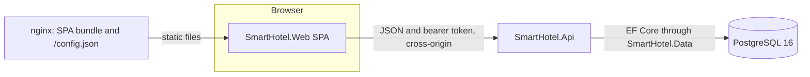

# SmartHotel

SmartHotel is a guest-facing hotel booking product. Guests register, log in, search hotels by city, dates and party size, compare room types with their nightly prices and availability, book a room, list their bookings and cancel them. Payment is simulated: a booking is confirmed on creation and no payment is taken online. Guests are the only user type.

The product is inspired by Microsoft's SmartHotel360 reference application. It is an original implementation: no code, names, data or assets were copied from it.

## Components

| Component | Path | Technology | Role |
|-----------|------|------------|------|
| Web app | `src/SmartHotel.Web` | Angular 17 single-page app, served by nginx | Screens, routing, forms, loading and error states, and the in-memory session |
| API | `src/SmartHotel.Api` | ASP.NET Core 8 REST API | A modular monolith with Auth, Hotels, Bookings and Availability modules. The only component that reads or writes data. |
| Data layer | `src/SmartHotel.Data` | Entity Framework Core 8 with the Npgsql provider | Entities, mappings and constraints, the `InitialCreate` migration and the seed routine |
| Database | — | PostgreSQL 16 | Persistence and constraint enforcement, used only by the API |

## Architecture



The web container's nginx serves the SPA bundle and `/config.json`, which tells the SPA where the API is. It does not proxy the API. The SPA calls the API cross-origin, and the API's single CORS policy admits only the web app's origin, with the methods `GET`, `POST` and `DELETE`, the headers `Authorization` and `Content-Type`, and no credentials.

## Repository layout

```text
.
├── .config/
│   └── dotnet-tools.json        # dotnet-ef local tool
├── deploy/
│   ├── acceptance.env           # intentionally empty Compose env file
│   └── db/                      # db-entrypoint.sh: first-start secrets
├── src/
│   ├── SmartHotel.Api/          # REST API, Dockerfile, container entrypoint
│   ├── SmartHotel.Data/         # EF Core model, migration, seed
│   └── SmartHotel.Web/          # Angular workspace, e2e suite, nginx template
├── tests/
│   ├── SmartHotel.Api.IntegrationTests/
│   └── SmartHotel.Api.UnitTests/
├── .dockerignore
├── .editorconfig
├── .env.example
├── .gitignore
├── Directory.Build.props
├── Directory.Packages.props
├── docker-compose.yml
├── global.json
├── README.md
└── SmartHotel.sln
```

## Prerequisites

### Supported hosts

| Host | Architecture | Container runtime | Where the tools and tests run |
|------|--------------|-------------------|-------------------------------|
| Windows 11, a release still in Microsoft servicing | x86-64 | Docker Desktop with the WSL 2 backend | Natively on Windows, or inside an Ubuntu 22.04/24.04 or Debian 12/13 WSL 2 distribution with Docker Desktop's WSL integration |
| macOS 15, 26 or 27 | arm64 (Apple silicon); x86-64 (Intel) only on macOS 15 and 26, because macOS 27 does not run on Intel Macs | Docker Desktop | Natively |
| Ubuntu 22.04 or 24.04; Debian 12 or 13 | x86-64 or arm64 | Docker Engine | Natively |

These are the combinations that every prerequisite supports: Playwright 1.60.0's system requirements, the .NET 8 supported-OS list and a supported Linux-container runtime. Excluded:

- Windows Server, because Docker Desktop does not support it.
- Windows on Arm, because Docker Desktop supports it only as early access.
- macOS 14, because it falls outside both Docker Desktop's support window (the current and two previous major releases) and the .NET 8 list.
- Other Linux distributions, because Playwright 1.60.0 does not list them.

### Tools

- Docker Engine 28.0 or later, with Docker Compose v2.1.1 or later (`docker compose up --wait` needs 2.1.1). Docker Desktop releases that bundle those versions qualify. Engine 28.0 is also the first release that stops other hosts on the LAN from reaching ports published on `127.0.0.1`.
- .NET SDK 8.0.428 exactly. `global.json` pins it with roll-forward disabled, so `dotnet` commands in this repository fail unless that exact SDK is installed.
- Node.js 20.20.2 with npm, for the web workspace and its tests.
- Playwright's Chromium 148.0.7778.96, installed per machine with `npx playwright install chromium` (see [Web tests](#web-tests)).

### Line endings

Running the product needs no Git line-ending setting. The repository has no `.gitattributes`, so your Git settings decide the line endings of a checkout, and an LF or a CRLF checkout, Git for Windows' default included, starts with the same `docker compose up`:

- The `db` service bind-mounts `deploy/db/db-entrypoint.sh` and runs it as checked out. A copy with CRLF endings runs itself again with the carriage returns removed.
- The API and web image builds strip carriage returns from the shell scripts they place in their images.

C# files use CRLF, as the root `.editorconfig` requires. Committing new C# files needs a repository-local Git setting, described under [Quality gates](#quality-gates).

## Run the product

From the repository root:

```bash
docker compose up
```

Or start in the background and return once every service is healthy:

```bash
docker compose up -d --wait
```

The services start in order, with no manual step:

1. `db` (PostgreSQL 16) starts. On the first start its entrypoint wrapper creates the local secrets. It is healthy once it accepts TCP connections.
2. `api` applies the committed migration, seeds the catalogue and only then starts listening. It is healthy once `/api/health` answers, so a healthy `api` means a migrated and seeded database.
3. `web` starts once `api` is healthy.

The `api` container is limited to 1 GiB of memory, and the API's garbage collector adapts its heap to the load (DATAS) within that limit.

| Address | Serves |
|---------|--------|
| `http://localhost:4200` | The web app |
| `http://localhost:8080/api` | The API |
| `http://localhost:8080/api/health` | The readiness probe: `200` with the plain-text body `Healthy` |

Every published port is bound to `127.0.0.1`, so nothing listens on other host interfaces. No database port is published, and the API is the only service that uses the database.

To use other host ports, set `SMARTHOTEL_API_PORT` (default `8080`) and `SMARTHOTEL_WEB_PORT` (default `4200`) in the shell or in `.env`. Compose derives the API's CORS origin (`Cors__AllowedOrigin`) and the SPA's API base URL (`API_BASE_URL`) from the same two variables, so the web app and CORS always agree:

```bash
SMARTHOTEL_API_PORT=9080 SMARTHOTEL_WEB_PORT=5200 docker compose up -d --wait
```

Each port must be one port number from `1` to `65535`, written in decimal without leading zeros. Compose itself also accepts `0` (a random port), ranges such as `14200-14201` and leading zeros such as `04200`, but none of them gives the CORS origin and the web app's API address one fixed port, written as browsers write it. The `api` container therefore exits at start with a message that names the variable, shown by `docker compose logs api`, and `docker compose up --wait` fails. Port `80` works as browsers write it: `SMARTHOTEL_WEB_PORT=80` gives the CORS origin `http://localhost`, and `SMARTHOTEL_API_PORT=80` makes the web app call `http://localhost/api`.

### Seed data

On the first start the API seeds five hotels in three cities:

| Hotel | City |
|-------|------|
| SmartHotel Seattle Downtown | Seattle |
| SmartHotel Seattle Waterfront | Seattle |
| SmartHotel New York Midtown | New York |
| SmartHotel New York Brooklyn | New York |
| SmartHotel Chicago Loop | Chicago |

- Every hotel has four room types: Standard and Deluxe for up to 2 guests, Family and Suite for up to 4.
- Each room type has 10 rooms, numbered 101–110, 201–210, 301–310 and 401–410. That makes 20 room types and 200 rooms in total.
- The first hotel's nightly prices are 129.00, 169.00, 219.00 and 329.00 USD, and each later hotel in the list charges 10.00 USD more per room type than the one before.
- Seeding runs only while no hotel exists, so a second start inserts nothing.

### Secrets

No secret lives in source or in committed configuration. The local stack has two secrets, the database password and the JWT signing key.

- On the first start the `db` service's wrapper, `deploy/db/db-entrypoint.sh`, writes each missing secret into the `secrets` volume as `/run/smarthotel-secrets/db_password` and `/run/smarthotel-secrets/jwt_signing_key`, with mode `0444`. A generated secret is 32 random bytes written as 64 hex characters.
- Only `db` and `api` mount the volume, and `api` mounts it read-only. Each container's entrypoint passes the secrets to its process only as environment variables: `POSTGRES_PASSWORD` for PostgreSQL, and `DB_PASSWORD` and `Jwt__SigningKey` for the API.

To choose the values yourself, set the optional first-start overrides `SMARTHOTEL_DB_PASSWORD` and `SMARTHOTEL_JWT_SIGNING_KEY` in the shell, or in a `.env` file copied from [`.env.example`](.env.example). Copying it is optional, and `.env` is git-ignored. A blank value is generated.

An override must have this format:

- A single line made only of the letters `A-Z` and `a-z`, the digits `0-9` and the characters `. _ ~ + / = -`. These need no quoting in the shell, in a connection string or in PostgreSQL's initialization.
- `SMARTHOTEL_DB_PASSWORD`: 16–128 characters.
- `SMARTHOTEL_JWT_SIGNING_KEY`: 32–256 characters.

On a first start the wrapper checks every override that is set before it writes anything. An invalid override makes `db` exit with a message that names the variable, never its value, so `db` never becomes healthy and `docker compose up --wait` fails.

### Signing in and out

A bearer token is valid for 60 minutes. The web app keeps it only in memory, never in `localStorage`, `sessionStorage` or a cookie, so reloading the page or opening a new tab signs the guest out. Logging out clears that in-memory session and returns to the search page. There is no logout endpoint, so a discarded token stays valid on the server until it expires.

## Reset and override semantics

The supported reset removes the database and the secrets together:

```bash
docker compose down -v
```

- Secret files are written only when absent, so `SMARTHOTEL_DB_PASSWORD` and `SMARTHOTEL_JWT_SIGNING_KEY` are read only on a first start. Later starts ignore them and log a notice.
- PostgreSQL applies its password only when it initializes an empty data directory, so a restart never changes the database role's password.
- A changed override therefore takes effect only after `docker compose down -v`.
- Removing only the `db-data` volume is safe: PostgreSQL re-initializes it with the retained password.
- Do not remove only the `secrets` volume while `db-data` survives. The next start generates a password that no longer matches the database role, and the API cannot connect. Recover with `docker compose down -v`.

## API overview

All endpoints are under `/api`. This table is a summary, not the full contract.

| Method and path | Auth | Purpose | Success |
|-----------------|------|---------|---------|
| `POST /api/auth/register` | None | Register a guest with `email`, `password` (8–128 characters) and `fullName` | `201` with `{ "guestId": … }` |
| `POST /api/auth/login` | None | Exchange an email and password for a bearer token | `200` with `token` and `expiresAt` |
| `GET /api/hotels` | None | Search by `city`, `checkIn`, `checkOut` and `guests` (default 1). Lists the hotels with at least one free room, each with its lowest nightly price. | `200`; `[]` when none qualify |
| `GET /api/hotels/{id}` | None | Hotel detail for `checkIn`, `checkOut` and `guests`: room types, nightly prices, available rooms per type and the stay total | `200` |
| `POST /api/bookings` | Bearer | Book a room type with `hotelId`, `roomTypeId`, `checkIn`, `checkOut` and `guests`. The server assigns the room and computes the total. | `201` with the booking |
| `GET /api/bookings` | Bearer | The caller's own bookings, newest first | `200`; `[]` when none |
| `DELETE /api/bookings/{id}` | Bearer | Cancel one of the caller's own bookings | `204` |
| `GET /api/health` | None | Readiness probe | `200`, `text/plain` body `Healthy` |

Conventions:

- Requests and responses are JSON with camelCase property names. Enums are strings, such as `Confirmed` and `Cancelled`. Timestamps are UTC ISO 8601 with a `Z` suffix, and money is a number in USD with two decimals.
- Dates are exactly `yyyy-MM-dd`. Other forms, such as `2026-1-5` or `12/07/2026`, return `400`.
- Every error is `application/problem+json`, whatever the `Accept` header says, with `type`, `title`, `status`, `detail` and `traceId`. A `400` also carries `errors`.
- That includes requests the server rejects before the API sees them, such as an over-long request line (`414`) or oversized headers (`431`), which is why the API serves HTTP/1.1.
- A stay is 1–30 nights, and check-in cannot be earlier than today's UTC date.
- The check-out day is not occupied: a stay that ends on the 12th and one that starts on the 12th can share a room.
- A bearer token from `POST /api/auth/login` is valid for 60 minutes. Send it as `Authorization: Bearer <token>`.
- Booking creation is atomic. Concurrent requests for the last free room produce one `201` and a `409` for every other request, never a double booking.
- The main error statuses are `400` for invalid input, `401` for a missing or rejected token or wrong credentials, `403` for another guest's booking, `404` for an unknown hotel, room type or booking, `409` for an email already registered, no free room, or a booking already cancelled or whose check-in date has passed, and `415` for a body that is not JSON.

## Testing

### API tests

From the repository root:

```bash
dotnet test
```

This runs `SmartHotel.sln`: the unit tests in `tests/SmartHotel.Api.UnitTests` and the integration tests in `tests/SmartHotel.Api.IntegrationTests`, which drive the real API pipeline in-process against a real PostgreSQL 16 server.

- By default the test fixture starts the `db-test` Compose service itself, in its own Compose project `smarthotel-test` with `--profile test`. The service is published on `127.0.0.1:55432`, accepts passwordless connections (trust authentication), sits alone on its own `testdb` network and keeps its data on tmpfs; its server log, like `db`'s, leaves out constraint DETAIL, failed statements and bind parameters. Docker must therefore be running. The fixture leaves the service running for the next run.
- To use another server instead, set `SMARTHOTEL_TEST_POSTGRES` to a full Npgsql connection string. The default is `Host=127.0.0.1;Port=55432;Username=postgres`. Its user must be a superuser, or have `CREATEDB` and `CREATEROLE`. A connection string can carry a password, so the fixture never prints the value.
- Each test class creates its own `smarthotel_it_<guid>` database and its own login role of the same name, with a random password, which owns the database. The class connects only as that role, never with the server's credentials, and drops both afterwards.

Focused runs:

```bash
# Twenty concurrent bookings for the last free room
dotnet test --filter "FullyQualifiedName~ConcurrentBookingTests"
# Every integration test, including the error matrix
dotnet test --filter "FullyQualifiedName~SmartHotel.Api.IntegrationTests"
# Missing tokens, and cancelling another guest's booking
dotnet test --filter "FullyQualifiedName~ListBookingsTests|FullyQualifiedName~CancelBookingTests"
```

Stop the test database:

```bash
docker compose -p smarthotel-test --profile test down
```

### Web tests

One-time setup:

```bash
cd src/SmartHotel.Web
npm ci
npx playwright install chromium
```

On Linux, install Chromium with its system dependencies instead: `npx playwright install --with-deps chromium`.

`ng test` uses the pinned Angular CLI in `node_modules/.bin`. Put that directory on `PATH` for the shell session, from `src/SmartHotel.Web`, then run `ng test`. In a POSIX shell:

```bash
export PATH="$PWD/node_modules/.bin:$PATH"
ng test
```

In PowerShell:

```powershell
$env:Path = "$PWD\node_modules\.bin;$env:Path"
ng test
```

`npx ng test` is equivalent. No globally installed Angular CLI is assumed, and `npm test` is not supported, because `package.json` defines no `test` script.

`ng test` runs Playwright Test, the web app's only test framework, through the in-repo Angular builder in `tools/playwright-builder`. Karma and Jasmine are not used. The suite runs in Chromium, one test at a time, with no retries, and Docker must be running.

#### Acceptance stack

Unless reuse mode is on, every `ng test` or `npx playwright test` run first builds a dedicated acceptance stack:

- It removes and rebuilds the Compose project `smarthotel-acceptance`: `down -v --remove-orphans`, then `up -d --build --force-recreate --wait`. The images are built from the current sources, and the volumes and secrets are fresh.
- It publishes the API on host port 18080 and the web app on host port 14200. The tests target `http://localhost:14200` and `http://localhost:18080/api`.
- Once both answer, setup requires the web app's `http://localhost:14200/config.json` to name `http://localhost:18080/api` as its API, in the canonical form the SPA uses, so the browser tests and the tests' direct API requests reach the same stack and database. A missing, invalid or different API base URL fails the run with a message that names the expected API and never prints the served value.
- Every Compose call names the project, the repository's `docker-compose.yml` and `--env-file deploy/acceptance.env`, an intentionally empty file. The Compose child process runs in a neutralized environment, without `COMPOSE_PROJECT_NAME`, `COMPOSE_FILE`, `COMPOSE_PROFILES`, `COMPOSE_ENV_FILES` or any `SMARTHOTEL_*` variable. Your own stack, its volumes and data, your `.env` and your overrides are never touched or read.
- Each Compose command has a deadline: 5 minutes for each `down -v --remove-orphans` (the removal before the build and the one after a failed `up`) and 30 minutes for `up -d --build --force-recreate --wait`, which leaves room for a first image build on a clean machine. A command still running at its deadline is stopped together with its whole process tree, and nothing else: the `docker` CLI, the Compose plugin it runs and every process they started are sent SIGTERM, and whatever is left of them is frozen with SIGSTOP, so that it cannot start another process, and sent SIGKILL after 10 seconds (on Windows, `taskkill /T /F` ends the tree at once). Setup then waits up to 10 more seconds for that tree to be gone and the command's output pipes to close, and releases the run's lock only after that wait, so a later run cannot overlap the stopped command. The run then fails with a message saying the command timed out after its deadline, after printing the command's filtered output. A timed-out `up`, like a failed one, is followed by `down -v` of the acceptance project; if that removal also fails or times out, setup prints the command that removes the project by hand. At most the last 1 MiB of characters of a command's output is kept, from the first line that starts within it; a line that limit cuts through is dropped whole, including the part of it written later, so the end of a line is never printed without its start. The printed output says when earlier output was omitted.
- If another process holds port 18080 or 14200 on `127.0.0.1` or `::1`, setup fails with a message naming the port. Both loopback addresses are checked because `localhost` can resolve to either; a host without IPv6 is checked on `127.0.0.1` alone. Setup never switches to other ports.
- Only one fresh run per host owns the acceptance stack at a time. It does so by listening on `127.0.0.1:18079` from before its first Compose call until it ends, and the operating system frees that port however the run ends, even when it is killed. A second fresh run started meanwhile fails before touching the stack, with a message naming the run that owns it: its process id, start time and checkout. If another program holds port 18079, the run fails with a message naming that port.

The stack stays up after the run. Remove it with:

```bash
docker compose -p smarthotel-acceptance down -v
```

#### Reuse mode

For local iteration, `E2E_REUSE_STACK=1` skips the bootstrap and runs the specs against an already running stack at `E2E_BASE_URL` (default `http://localhost:4200`) and `E2E_API_URL` (default `http://localhost:8080/api`). Setup then only checks that `<E2E_API_URL>/health` answers `Healthy` and that the web root answers. Use `localhost` in both URLs, because the stack's CORS origin and the SPA's API base URL are `localhost` origins. `E2E_REUSE_STACK` accepts only `1`; leave it unset or empty for a fresh run. Any other value, such as `true`, `yes` or `0`, fails the run before any Compose call, so a mistyped value never removes and rebuilds the acceptance stack. Each URL must be an absolute `http` or `https` URL made only of printable ASCII, with no user name, password, query or fragment; `E2E_BASE_URL` must be an origin (a trailing `/` is allowed) and the path of `E2E_API_URL` must be `/api` (a trailing `/` is allowed), otherwise the run fails before any spec with an error that names the variable without printing its value.

```bash
E2E_REUSE_STACK=1 ng test
```

A reuse run never counts as evidence for a success criterion. A fresh run ignores both URLs.

#### Focused Playwright runs

From `src/SmartHotel.Web`:

```bash
npx playwright test e2e/booking-journey.spec.ts
npx playwright test e2e/navigation.spec.ts
npx playwright test e2e/stack.spec.ts
```

Each one builds the acceptance stack first, unless reuse mode is on.

### Success criteria

| # | Criterion | Verified by |
|---|-----------|-------------|
| 1 | A new guest registers, logs in, searches a seeded city for a 2-night stay, opens a hotel, books a room and sees the booking in the list, all in a browser | `src/SmartHotel.Web/e2e/booking-journey.spec.ts` |
| 2 | After that booking the same room type shows one fewer available room, and after cancelling the count returns to its original value | The same test, continuing with that booking |
| 3 | 20 concurrent bookings for a room type with 1 free room return exactly one `201` and nineteen `409` | `ConcurrentBookingTests` |
| 4 | Every endpoint returns each listed error status for its trigger | The integration error matrix in `tests/SmartHotel.Api.IntegrationTests` |
| 5 | Listing or cancelling bookings without a token returns `401`, and cancelling another guest's booking returns `403` | `ListBookingsTests` and `CancelBookingTests` |
| 6 | Every route and component is reachable from the app's navigation, and every endpoint has a caller | `src/SmartHotel.Web/e2e/navigation.spec.ts` |
| 7 | One `docker compose up` starts and seeds everything, and hotel search answers within 1 second at the 95th percentile with 20 concurrent users | The acceptance-stack bootstrap, `src/SmartHotel.Web/e2e/stack.spec.ts` and `SeedTests` |
| 8 | Unit tests cover price calculation and the overlap rule, including the check-out-day boundary, and each side runs with one command | The unit tests in `tests/SmartHotel.Api.UnitTests`, with `dotnet test` and `ng test` both exiting 0 |

## Quality gates

Every gate must pass with zero warnings. From the repository root:

```bash
dotnet format SmartHotel.sln --verify-no-changes
dotnet build SmartHotel.sln
```

From `src/SmartHotel.Web`, with the CLI on `PATH`:

```bash
ng lint
ng build
```

- `Directory.Build.props` sets `TreatWarningsAsErrors`, so any compiler, analyzer or NuGet warning fails `dotnet build` and `dotnet test`.
- The root `.editorconfig` holds the unchanged rules that `dotnet new editorconfig` emits from SDK 8.0.428. They require C# files to use CRLF line endings with no final newline, so run `dotnet format SmartHotel.sln` before committing C# changes.
- Commit C# files from a clone whose line-ending conversion is turned off for that repository only: `git clone -c core.autocrlf=false <repository-url>`. Its files keep their committed endings, and new files are committed as written. Git for Windows' default `core.autocrlf=true`, like `core.autocrlf=input`, commits a new CRLF C# file with LF endings, which `dotnet format --verify-no-changes` then rejects in every other checkout.
- `ng lint` applies angular-eslint 17's default rules with `maxWarnings: 0`, and `ng build` must finish without warnings.

### Commands a pipeline would run

No CI pipeline file ships in this version. A pipeline would run these commands in order, starting from the repository root:

```bash
docker compose config -q
dotnet format SmartHotel.sln --verify-no-changes
dotnet build SmartHotel.sln
dotnet test
cd src/SmartHotel.Web && npm ci && npx playwright install --with-deps chromium && npx ng lint && npx ng build && npx ng test
```

## Database migrations

The schema is the committed `InitialCreate` migration in `src/SmartHotel.Data/Migrations`, with its designer file and the model snapshot. At startup the API applies any pending migration and then seeds, before it starts listening. This assumes a single API instance.

Two statements in that migration are hand-added SQL: the exclusion constraint `EX_Bookings_Room_NoOverlap`, which uses the `btree_gist` extension so that no two `Confirmed` bookings of one room can overlap, and the expression index `IX_Hotels_City_Lower`, which serves the case-insensitive city search.

To add a migration, from the repository root, replacing `<Name>` with the migration's name:

```bash
dotnet tool restore
dotnet ef migrations add <Name> --project src/SmartHotel.Data --startup-project src/SmartHotel.Api --output-dir Migrations
dotnet format SmartHotel.sln
```

`dotnet tool restore` installs `dotnet-ef` 8.0.34 from `.config/dotnet-tools.json`, and `dotnet format` brings the generated files in line with the `.editorconfig` rules.

The `dotnet ef` commands need none of the API's secrets or `DB_*` variables: they create the context through `src/SmartHotel.Data/DesignTimeDbContextFactory.cs`, whose connection string is a passwordless placeholder, so a command that must reach a database, such as `dotnet ef database update`, takes it from its `--connection "<connection string>"` option.

## Configuration

The API reads secrets only from process environment variables, never from `appsettings*.json`, command-line arguments or any other configuration source. A signing key placed in a JSON file is ignored, and startup then fails validation. The non-secret settings, `Jwt:Issuer`, `Jwt:Audience` and the log levels, are in `src/SmartHotel.Api/appsettings.json`.

### Local Compose variables

| Variable | Default | Purpose |
|----------|---------|---------|
| `SMARTHOTEL_API_PORT` | `8080` | Host port of the API: one port number from `1` to `65535`, in decimal without leading zeros. `0`, a range or a leading zero makes the `api` container exit at start with a message naming the variable, so `docker compose up --wait` fails ([port rules](#run-the-product)). Also sets the web app's `API_BASE_URL`. |
| `SMARTHOTEL_WEB_PORT` | `4200` | Host port of the web app, in the same format and with the same check. Also sets the API's `Cors__AllowedOrigin`; port `80` gives the origin `http://localhost`. |
| `SMARTHOTEL_DB_PASSWORD` | Blank, so generated | First-start override of the database password, in the [secret format](#secrets) |
| `SMARTHOTEL_JWT_SIGNING_KEY` | Blank, so generated | First-start override of the JWT signing key, in the [secret format](#secrets) |

[`docker-compose.yml`](docker-compose.yml) sets everything else for the local stack. The API gets `ASPNETCORE_ENVIRONMENT=Development`, `ASPNETCORE_HTTP_PORTS=8080`, `DB_HOST`, `DB_PORT`, `DB_NAME`, `DB_USER`, `SMARTHOTEL_SECRETS_DIR`, `Cors__AllowedOrigin=http://localhost:<web port>`, and `SMARTHOTEL_API_PORT` and `SMARTHOTEL_WEB_PORT` themselves, which its entrypoint checks before the API starts; for web port `80` the entrypoint writes the origin as `http://localhost`. The web container gets `API_BASE_URL=http://localhost:<api port>/api` and `WEB_ENVIRONMENT=Development`, which it renders into `/config.json`.

### Outside local development

| Component | Variable | Value | Secret |
|-----------|----------|-------|--------|
| API | `ASPNETCORE_ENVIRONMENT` | `Production`, ASP.NET Core's default when unset | No |
| API | `ASPNETCORE_HTTPS_PORTS` or `ASPNETCORE_URLS` | For example `443` or `https://+:443` | No |
| API | `Kestrel__Certificates__Default__Path` | Path of the TLS certificate file | No |
| API | `Kestrel__Certificates__Default__Password` | The default certificate's password, read only from this environment variable | Yes |
| API | `ConnectionStrings__SmartHotel` | A full Npgsql connection string, used whole when set | Yes, it holds the password |
| API | `DB_HOST`, `DB_PORT`, `DB_NAME`, `DB_USER`, `DB_PASSWORD` | The connection string's parts, used when `ConnectionStrings__SmartHotel` is unset. `DB_HOST`, `DB_NAME`, `DB_USER` and `DB_PASSWORD` must then be set and not blank; `DB_PORT` defaults to `5432`. The assembled string caps the connection pool at 50. | `DB_PASSWORD` only |
| API | `Jwt__SigningKey` | At least 32 bytes in UTF-8 | Yes |
| API | `Cors__AllowedOrigin` | `https://<web origin>`, a bare origin with no path and no trailing slash | No |
| API | `Jwt__Issuer`, `Jwt__Audience` | Optional. The defaults are `SmartHotel.Api` and `SmartHotel.Web`, from `appsettings.json`. | No |
| Web | `API_BASE_URL` | `https://<api host>/api` | No |
| Web | `WEB_ENVIRONMENT` | `Production` | No |

Supply the secrets through the hosting environment's secret mechanism, never in a committed file. Outside Compose, leave `SMARTHOTEL_SECRETS_DIR` unset: the API container's entrypoint then reads no secret files and uses the variables above as they are set.

Kestrel reads its `Kestrel` settings from the usual configuration sources, except a certificate password, which it reads only from the environment: `Kestrel__Certificates__Default__Password`, or `Kestrel__Endpoints__<name>__Certificate__Password` for an endpoint's own certificate. A password in `appsettings*.json`, user secrets or a `--Kestrel:...:Password` command-line argument is ignored, so a password-protected certificate configured that way fails to load and the API does not start.

### Host test runner variables

| Variable | Default | Purpose |
|----------|---------|---------|
| `SMARTHOTEL_TEST_POSTGRES` | Unset: the fixture starts `db-test` and uses `Host=127.0.0.1;Port=55432;Username=postgres` | The PostgreSQL server for the integration tests. Its user must be a superuser, or have `CREATEDB` and `CREATEROLE`. A full connection string can carry a password, and the fixture never prints it. |
| `E2E_REUSE_STACK` | Unset | `1` selects reuse mode for the web tests. Unset or empty runs a fresh acceptance stack. Any other value fails the run before any Compose call. |
| `E2E_BASE_URL` | `http://localhost:4200` | The web app to target, in reuse mode only |
| `E2E_API_URL` | `http://localhost:8080/api` | The API base to target, in reuse mode only |

## HTTPS outside local development

The local Compose stack runs as `Development` over plain HTTP on loopback-bound ports. Every other environment enforces HTTPS end to end:

- The API turns on HSTS and HTTPS redirection, and Kestrel serves HTTPS with the listener and certificate variables above.
- A plaintext request the API cannot redirect, because it finds no HTTPS port to redirect to, is answered `403` with an `application/problem+json` body whose `detail` is `This API accepts HTTPS requests only.` It is refused before CORS and authentication, so credentials and tokens sent over plain HTTP are never processed. When Kestrel listens on several HTTPS ports beside an HTTP one, set `ASPNETCORE_HTTPS_PORT` to the port to redirect to; without it ASP.NET Core's redirection fails and every plaintext request gets a generic `500` problem, again before anything else runs.
- When Kestrel binds no HTTPS address at all, the API logs a critical event that names `ASPNETCORE_HTTPS_PORTS`, `ASPNETCORE_URLS` and the certificate variables, never their values, and stops with exit code 1.
- Kestrel reads a certificate password only from the environment: `Kestrel__Certificates__Default__Password` for the default certificate, or `Kestrel__Endpoints__<name>__Certificate__Password` for an endpoint's own certificate. A password in `appsettings*.json`, user secrets or on the command line is ignored, as described under [Outside local development](#outside-local-development).
- When the host fails to start, for example because Kestrel cannot load the certificate, the API logs one critical event, `5202`, that names the exception types and the listener and certificate variables to check, never an exception message or a value, and exits with code 1.
- The API refuses to start unless `Cors__AllowedOrigin` is an `https://` origin.
- The hosting environment's TLS termination must serve the web origin over HTTPS.
- `API_BASE_URL` must be `https://<api host>/api`. The SPA accepts an `http` API base only for `localhost` or `127.0.0.1`, and only when `WEB_ENVIRONMENT` is `Development`. Any other configuration shows a start-up error instead of the app.

Certificate provisioning and deployment automation are out of scope for this version.

## Security notes

- Passwords are hashed with PBKDF2-HMAC-SHA512 through ASP.NET Core Identity's password hasher, with 220,000 iterations and a 128-bit salt. No response ever contains a password hash.
- Login answers an unknown email and a wrong password identically, so it does not reveal whether an account exists.
- Guests can cancel only their own bookings. Cancelling another guest's booking returns `403`.
- CORS admits only the web app's origin.
- The web app keeps the token in memory only and attaches it only to requests for the API's `/api` paths.
- An unhandled error returns a generic `500` problem with no exception message or stack trace.
- The product stores no personal data beyond email and full name and no payment data, and it uses no third-party services.

## Scope

Not part of this version:

- Real payment processing. A booking is confirmed on creation, and the confirmation says that no payment is taken online.
- Native mobile apps, smart-room and IoT controls, and staff or admin consoles.
- Reviews, loyalty points, multiple languages and multiple currencies. The text is English and prices are in USD.
- Email or push notifications. The booking confirmation is shown on screen only.
- Server-side token revocation and a logout endpoint.
- Running several API instances. Startup migration assumes one.
- Internationalized (non-ASCII) email addresses.
- Running the API or the SPA directly on the host. Docker Compose is the only run path.
- Component unit tests for the web app. Playwright is the only web test framework.
- CI pipeline files. See [Commands a pipeline would run](#commands-a-pipeline-would-run).

## Support status and accepted risks

- .NET 8 reached end of support on 10 November 2026, Angular 17 left long-term support on 15 May 2025, and Node.js 20 reached end of life on 30 April 2026. None of them receives further fixes. The project pins each line's final patch.
- Under `TreatWarningsAsErrors`, a NuGet audit advisory published later against a pinned package fails the build until it is addressed.
- Playwright stays at 1.60.0, the newest release whose documentation lists Node.js 20 support. Later releases document only Node.js 22 and newer, which Angular 17 does not support.
- The search latency check measures the machine that runs the stack, so its result depends on the hardware.
- `db-test` accepts passwordless connections. Only its own Compose network and host loopback can reach it, and other LAN hosts are blocked from loopback-published ports only on Docker Engine 28.0 or later.
- Startup migrations are safe only while a single API instance runs.
- A fresh `ng test` run resets only its own `smarthotel-acceptance` project. That stack stays up on ports 18080 and 14200 until the next run or `docker compose -p smarthotel-acceptance down -v`.
- The token is kept in memory, so reloading the page or opening a new tab signs the guest out.
