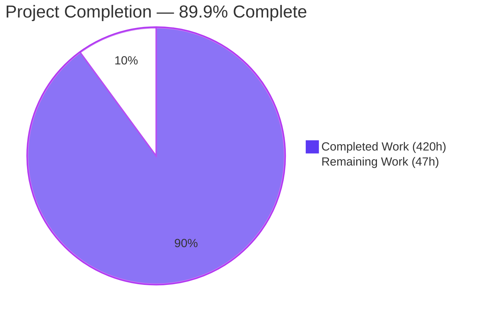
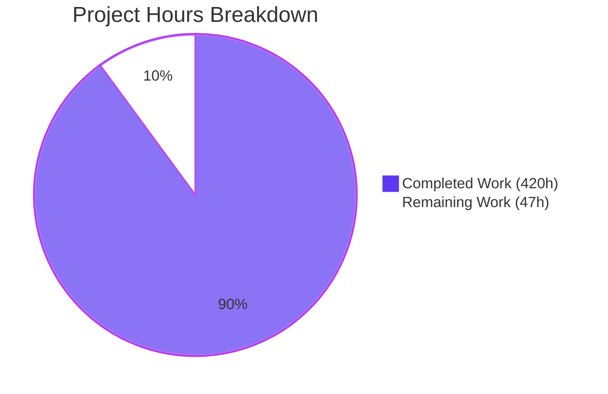
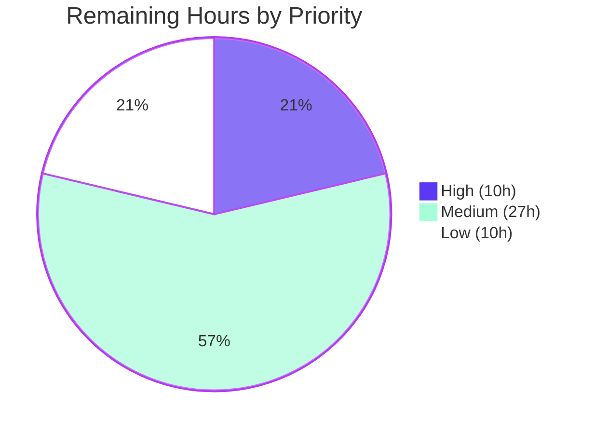

# 1. Executive Summary

## 1.1 Project Overview

SmartHotel is a guest-facing hotel booking product, built as a production-shaped first version. One `docker compose up` starts all three parts: an Angular 17 SPA, an ASP.NET Core 8 modular-monolith API (Auth, Hotels, Bookings, Availability) and an EF Core 8 data layer on PostgreSQL 16. Guests register, search seeded hotels, compare room types, book atomically, and list or cancel bookings. Payment is simulated. The delivery is 152 files: code, seed, Compose packaging, 613 automated tests and a README.

## 1.2 Completion Status



| Metric | Value |
|---|---|
| Total Hours | 467 |
| Completed Hours (Baseline: Human with agentic-assist) | 420 |
| Remaining Hours | 47 |
| Completion | 89.9% |

**420 hours completed out of 467 total hours = 89.9% complete.** Every AAP requirement is implemented and verified. The remaining hours cover:
- Low-severity fixes;
- tests for areas no automated test reaches;
- the clean-machine and production-configuration runs;
- code review.

## 1.3 Key Accomplishments

- ✅ All 8 success criteria pass, led by the browser journey from registration through booking to cancellation.
- ✅ Atomic booking: 20 concurrent requests for the last room return one 201 and nineteen 409s.
- ✅ Every API error is `application/problem+json`, covered by 130 contract tests.
- ✅ JWT authentication: HS256, 60-minute tokens, zero clock skew. Passwords use PBKDF2 at 220,000 iterations.
- ✅ One `docker compose up` migrates, seeds and starts the stack, generating its secrets.
- ✅ Search p95 is 23.4 ms with 20 concurrent users, against a 1,000 ms target.
- ✅ Zero-warning build, format and lint gates; no vulnerable NuGet package.
- ✅ 613 of 613 tests pass. .NET line coverage is 82.8%.

## 1.4 Critical Unresolved Issues

**0 of 8 success criteria are open.**
- 34 Low-severity residual items remain, none on the booking journey.
- 6 areas are untested (Section 3).
- 2 verification runs are outstanding: the fresh-mode acceptance run and the production-configuration run.

No divergence blocks release.

| Issue | Impact | Owner | ETA |
|---|---|---|---|
| Web behaviour residuals (12). Examples: the loading bar stays about 7 s after Log out while a booking is in flight; `/favicon.ico` is served as the app page; an extra history entry appears after reloading My bookings. | Edge-case UX only; no data impact | Web developer | 10 h |
| Accessibility and presentation residuals (7). Examples: `role="alert"` sits on the inner element of `ErrorMessageComponent`; every Book button has the accessible name "Book"; focus does not move on entry to Search or My bookings. | Screen-reader and narrow-viewport polish | Web developer | 5 h |
| API and operations residuals (6). Examples: `GET /api/hotels/%201` is accepted as hotel 1; startup TLS errors name only the default certificate path. | Minor input leniency and diagnostics | Backend developer | 4 h |
| Toolchain and test-harness residuals (9). Examples: `fsevents` is missing from npm `allowScripts`; a Compose command stopped at its deadline leaves the acceptance barrier file behind. | Developer-machine friction only | DevOps / QA | 4 h |
| Built but never exercised (6 areas; Section 3) | Defects there would surface only in use | QA | 8 h |
| Fresh-mode acceptance run and production (non-Development) HTTPS run outstanding | Formal criterion evidence and the HTTPS path are unsigned | QA / DevOps | 6 h |

## 1.5 Access Issues

No access issues identified. Restores, image builds and all test suites ran with existing permissions. Secrets are generated locally, so no external credential is needed.

## 1.6 Recommended Next Steps

1. [High] On a clean machine, run fresh-mode `npx ng test` and a plain `docker compose up`.
2. [High] Review the change set, starting with `src/SmartHotel.Api/Program.cs` and `src/SmartHotel.Api/Modules/Bookings/BookingService.cs`.
3. [Medium] Run the stack outside Development with a real certificate, and confirm HSTS and the HTTPS redirect.
4. [Medium] Add tests for the CORS policy, secret source, entrypoint scripts and uncovered SPA states.
5. [Low] Decide the four open divergence questions in Section 5.2.

# 2. Project Hours Breakdown

## 2.1 Completed Work Detail

| Component | Hours | Description |
|---|---|---|
| Solution, toolchain pins and quality gates | 8 | Delivered:<br>- `SmartHotel.sln` and `global.json` (SDK 8.0.428, no roll-forward);<br>- exact NuGet pins with transitive pinning in `Directory.Packages.props`;<br>- `TreatWarningsAsErrors`, default `.editorconfig`, angular-eslint and strict `tsconfig.json`;<br>- the `dotnet-ef` 8.0.34 tool manifest. |
| Data layer: schema, constraints, migration and seed | 20 | Delivered:<br>- five entities and their mappings;<br>- the `btree_gist` exclusion constraint `EX_Bookings_Room_NoOverlap`;<br>- the composite room/hotel key and the case-insensitive city index;<br>- the `InitialCreate` migration;<br>- an idempotent seed of 5 hotels, 20 room types and 200 rooms (`src/SmartHotel.Data`). |
| API host, error contract and security pipeline | 44 | In `Program.cs` and `Infrastructure/*`:<br>- the problem+json envelope for every 4xx/5xx, including server-level rejections;<br>- a sanitized 500 response and log redaction;<br>- HTTPS redirect and HSTS outside Development;<br>- the single-origin CORS policy and security headers;<br>- fail-fast options validation, then migrate before seed at startup;<br>- an environment-only secret source and the EF retry strategy. |
| Auth module (FR-1 to FR-3) | 22 | Delivered:<br>- register and login with input normalization;<br>- PBKDF2 hashing at 220,000 iterations with rehash;<br>- HS256 60-minute tokens with exact `exp`, `iat` and `nbf`;<br>- an identical 401 for every login failure, using a dummy hash;<br>- a token rejected when it names no registered guest. |
| Hotels search, detail and availability rules (FR-4, FR-5, R1, R3, R4) | 22 | Delivered:<br>- `GET /api/hotels` and `GET /api/hotels/{id}`;<br>- the half-open overlap rule in `StayRules`;<br>- `StayPeriod` (1 to 30 nights, no past check-in);<br>- exact `yyyy-MM-dd` parsing in `IsoDate`;<br>- server-side pricing in `PriceCalculator`. |
| Bookings and concurrency (FR-6 to FR-8, R2) | 30 | In `BookingService`:<br>- allocation of the lowest free room under a `FOR UPDATE` row lock, with an exclusion-violation 409;<br>- the guest's own list, newest first;<br>- conditional cancellation with 403, 404 and 409 rules. |
| SPA core | 28 | Delivered:<br>- runtime `/config.json` with boot loading and boot error screens;<br>- an in-memory session;<br>- auth, loading and request-deadline interceptors;<br>- typed API clients and error mapping;<br>- the `authGuard` and the two branches of the 401 rule. |
| SPA screens and accessibility | 52 | Screens:<br>- Search, Hotel detail, Login, Register and My bookings;<br>- the nav bar, loading indicator and error message.<br>Behaviour:<br>- the confirmation banner and Cancel eligibility;<br>- paging, compact narrow layouts, forced-colours styles and keyboard focus handling. |
| Containers, Compose and secret bootstrap | 30 | Delivered:<br>- API and web Dockerfiles;<br>- the nginx template, covering CSP, cache policy and `/config.json` rendering;<br>- `deploy/db/db-entrypoint.sh`, which generates secrets on first start;<br>- `docker-compose.yml` with health-ordered start, loopback-only ports and derived CORS and API URLs. |
| Unit tests | 8 | 110 xUnit tests for pricing, stay rules, stay period and ISO dates (`tests/SmartHotel.Api.UnitTests`). |
| Integration tests and PostgreSQL harness | 60 | 321 tests: the error-case matrix, concurrency and constraints. They run on the `TestPostgres` fixture (one database per class), `SmartHotelApiFactory`, `ApiTestClient` and `ProblemAssert`. |
| End-to-end suite and `ng test` builder | 52 | 182 Playwright tests, using `e2e/global-setup.ts` for the acceptance stack in fresh and reuse modes, behind the in-repo `tools/playwright-builder` that `ng test` runs. |
| Documentation | 12 | `README.md` (583 lines: prerequisites, run, tests, reset, variables, HTTPS, support status), XML docs on public C# and TSDoc on exported TypeScript. |
| Cross-cutting validation and hardening | 32 | Verification and hardening across five areas:<br>- security: injection, open redirect, transport;<br>- responsive layouts at 375 to 1280 px;<br>- keyboard and screen-reader behaviour;<br>- performance;<br>- unattended stack lifecycle. |
| **Total** | **420** | |

## 2.2 Remaining Work Detail

| Category | Hours | Priority |
|---|---|---|
| Formal clean-machine acceptance run: fresh-mode `npx ng test` and plain `docker compose up` on a host with no cached images, signing off criteria 1, 2, 6 and 7 | 2 | High |
| Code review and sign-off of the 152-file change set | 8 | High |
| Production-configuration verification outside Development: real certificate, `https` CORS origin, HSTS, injected secrets, `WEB_ENVIRONMENT=Production` | 4 | Medium |
| Automated tests for never-exercised areas (Section 3) | 8 | Medium |
| Web behaviour residuals (12 items, Section 1.4) | 10 | Medium |
| Accessibility and presentation residuals (7 items), including moving `role="alert"` to the `ErrorMessageComponent` root | 5 | Medium |
| API and operations residuals (6 items) | 4 | Low |
| Toolchain and test-harness residuals (9 items), including `fsevents` in `allowScripts` | 4 | Low |
| Decisions on the open divergences (Section 5.2): npm overrides, HTTP/1.1-only Kestrel, fixed 5xx text, accepted Angular 17 advisories | 2 | Low |
| **Total** | **47** | |

## 2.3 Completion Calculation

- **Completed hours:** every AAP deliverable is Completed and counts at full value, totalling 420 h (Section 2.1).
- **Remaining hours:** 47 h of quality and path-to-production work traced to those deliverables (Section 2.2).
- **Total:** 420 + 47 = 467 h.
- **Completion:** 420 / 467 × 100 = **89.9%**.
- **Confidence:** medium.
  - Each residual fix is small and well located.
  - Review time scales with a change of 67,246 added lines, 14,082 of them in `package-lock.json`.

| Requirement group | Items | Status |
|---|---|---|
| Functional requirements FR-1 to FR-11 and the health endpoint | 12 | Completed |
| Contract, security and runtime requirements (T7, R1–R6, K1–K5) | 14 | Completed. HTTPS is verified in tests but not in a production run. |
| Success criteria 1 to 8 | 8 | Completed (all pass) |
| File plan, documentation, conventions, web UI rules, Compose-only run path | 5 | Completed |
| Environment notes (SQLite, separate services, `dotnet run`) | 3 | Superseded by the AAP (Section 5.2) |

# 3. Test Results

The figures below come from full runs on the delivered tree.
- **.NET:** `dotnet test SmartHotel.sln -c Release` against PostgreSQL 16, under `dotnet-coverage`.
- **Web:** `npx ng test`, run in reuse mode against a newly built Compose stack (fresh volumes, current images, generated secrets).

| Area / Category | Framework | Tests | Passed | Failed | Coverage | What This Proves |
|---|---|---|---|---|---|---|
| Domain rules: pricing, stay rules, stay period, ISO dates | xUnit v3 (unit) | 110 | 110 | 0 | 82.8% line (.NET suite) | Totals, the 1–30 night limit, the check-out-day boundary and exact date syntax behave as specified |
| Auth API: register, login, token validation | xUnit v3 + real PostgreSQL | 76 | 76 | 0 | 82.8% line (.NET suite) | Accounts, 60-minute tokens, uniform 401s and strict JWT validation hold |
| Hotels API: search and detail | xUnit v3 + real PostgreSQL | 36 | 36 | 0 | 82.8% line (.NET suite) | Availability, ordering, per-type counts and every 400/404 trigger match the contract |
| Bookings API: create, list, cancel, 20-way race | xUnit v3 + real PostgreSQL | 62 | 62 | 0 | 82.8% line (.NET suite) | No double booking under contention; ownership, 401/403/404/409 rules hold |
| Data layer: constraints and seed | xUnit v3 + real PostgreSQL | 17 | 17 | 0 | 72.2% line (`SmartHotel.Data`) | The database itself rejects overlaps and bad data; the seed is exact and idempotent |
| HTTP error contract | xUnit v3 (in-process and child-process API) | 130 | 130 | 0 | 79.2% line (`SmartHotel.Api`) | Every error is `application/problem+json`, including server-level rejections and startup failures |
| Browser journey, navigation and stack | Playwright 1.60 (Chromium) | 43 | 43 | 0 | Not measured | Criteria 1, 2, 6 and 7 hold; nginx input checks and CSP behave as specified; search p95 is 23.4 ms |
| Web UI states and accessibility | Playwright 1.60 (Chromium) | 139 | 139 | 0 | Not measured | Loading, empty, inline-error, 401 and redirect states, plus keyboard focus handling |

**Totals:** 613 tests, 613 passed, 0 failed.
- .NET coverage is 82.8% line and 62.6% branch.
- Static gates: `dotnet build` with 0 warnings, `dotnet format --verify-no-changes`, `ng lint` and `ng build` with 0 warnings (356.33 kB initial bundle).
- `dotnet list package --vulnerable` finds no vulnerable package.

**Not Covered** — delivered but not exercised by any automated test:
- **CORS policy, secret source and entrypoints.** `ApiCorsOptionsValidator`, `EnvironmentSecretSource`, `deploy/db/db-entrypoint.sh` and the API container entrypoint run only when the stack starts. Test a disallowed origin, missing or short secrets, and malformed override values.
- **HTTPS outside Development.** Tests cover the redirect, the 403 for plaintext and the exit when no HTTPS listener exists, but the HSTS header is never asserted. No stack with a real certificate has been started.
- **Defensive API branches.** Untested branches:
  - the create-booking timeout fallback;
  - cancel when `pg_xact_status` returns NULL;
  - a failure inside the server-rejection observer;
  - a Kestrel configuration reload;
  - shutdown during startup;
  - `StartupErrorHandler`.
- **SPA edge states and layouts.** Untested:
  - Login and Register submit disabled while pending;
  - Book 400 and 404 inline errors;
  - a new tab starting signed out;
  - the late-booking link opened in a new tab;
  - a local 404 on cancel;
  - the browser date-format fallback;
  - narrow layouts: My bookings compact rows below 64rem and the pinned hotel-detail columns. Only one 320 px focus case runs below the default viewport.
- **Other browsers and hosts.** Firefox and WebKit are untested. So are Windows and macOS harness paths (process-tree stop, named pipes, `%APPDATA%` files) and firewalld hosts.
- **Test-fixture fallbacks.** Dropping a test database without privilege (SQLSTATE 42501) and a fixture dispose whose stop never completes.

# 4. Runtime Validation & UI Verification

The product was driven as a running Compose stack (`db`, `api`, `web`) built from the delivered sources, through `curl` and through Chromium.

- ✅ **Start-up:** `up --build --wait` exited 0 with all three services healthy.
  - The database was migrated and seeded and the secrets were generated, with no manual step.
  - `GET /api/health` returns `Healthy` as `text/plain`.
  - `/config.json` names the API origin.
- ✅ **Authentication:** `POST /api/auth/register` returns 201 with `guestId`. `POST /api/auth/login` returns 200 with a 60-minute token. A request with no token gets a 401 `application/problem+json` response with `WWW-Authenticate: Bearer`.
- ✅ **Search and detail:** a 2-guest Seattle search returns 2 hotels, ordered at $129 and $139. The hotel detail lists Standard, Deluxe, Family and Suite with 10 free rooms each. A blank city returns 400 with `errors.city`.
- ✅ **Booking lifecycle:** booking returns 201 (room 101, total $258.00, `Confirmed`); the list returns 200; cancelling returns 204; cancelling again returns 409.
- ✅ **Web journeys in Chromium:** the full guest journey plus every loading, empty, inline-error, 401 and redirect state passed (182 of 182).
- ✅ **CORS and web hosting:** a preflight from the web origin returns 204 with that origin allowed. The web server sends the Content-Security-Policy and security headers.
- ✅ **Performance:** 500 search samples from 20 concurrent users gave a p95 of 23.4 ms, against a 1,000 ms limit.
- ⚠ **Fresh-mode acceptance run:** the browser suite was driven in reuse mode, and the AAP counts only a fresh-mode run as criterion evidence. That run, which builds the dedicated `smarthotel-acceptance` stack, still needs a sign-off on a clean machine.
- ❌ **Production configuration:** the stack has never run outside Development with a real certificate, an `https` CORS origin and `WEB_ENVIRONMENT=Production`.
- ❌ **Other browsers, hosts and narrow layouts:** Firefox, WebKit, Windows and macOS hosts, and the compact narrow-viewport layouts were never exercised by an automated runtime check.

# 5. Compliance & Quality Review

## 5.1 Compliance Matrix

| Deliverable (AAP) | Benchmark | Status | Progress | Evidence |
|---|---|---|---|---|
| Auth: register, login, logout (S1, FR-1 to FR-3) | Contract, hashing, token rules | ✅ Pass | 100% | `tests/SmartHotel.Api.IntegrationTests/Auth/` (76 tests) |
| Hotel search and detail (S2, S3, FR-4, FR-5) | Contract and availability rules | ✅ Pass | 100% | `tests/SmartHotel.Api.IntegrationTests/Hotels/` (36 tests) |
| Bookings and atomicity (S4, R2, FR-6 to FR-8) | One 201 and nineteen 409s; no double booking | ✅ Pass | 100% | `tests/SmartHotel.Api.IntegrationTests/Bookings/` (62 tests, including `ConcurrentBookingTests.cs`) |
| Schema and seed (S5, T3, T6) | Database-enforced invariants; exact, idempotent seed | ✅ Pass | 100% | `tests/SmartHotel.Api.IntegrationTests/Data/` (17 tests) |
| Error contract (T7) | problem+json on every error, whatever the `Accept` header | ✅ Pass | 100% | `tests/SmartHotel.Api.IntegrationTests/Http/ProblemDetailsContractTests.cs` (130 tests) |
| Web app states and reachability (R6, criterion 6) | Every route reached by clicks; every state handled | ✅ Pass | 100% (34 Low residuals open) | `src/SmartHotel.Web/e2e/navigation.spec.ts`, `ui-states.spec.ts` |
| One-command local run (T5, criterion 7) | No manual step; health-ordered start | ✅ Pass | 100% (fresh-mode sign-off pending) | `docker-compose.yml`, `src/SmartHotel.Web/e2e/stack.spec.ts` |
| Secrets and privacy (K1, K2) | Secrets from the environment only; email and name only | ✅ Pass | 100% (no committed test for the secret source) | `.env.example`, `deploy/db/db-entrypoint.sh`, `src/SmartHotel.Api/appsettings.json` |
| HTTPS and CORS (K3) | HTTPS outside Development; a single CORS origin | ⚠ Partial verification | 85% | HTTPS tested in a child-process API; never run in production configuration |
| Dependencies (K4) | Exact pins, limited to the named stack | ⚠ Pass with divergence | 95% | `Directory.Packages.props`; `src/SmartHotel.Web/package.json` has 20 transitive `overrides` |
| Linting and warnings (K5) | Default rules; zero warnings | ✅ Pass | 100% | `Directory.Build.props`, `.editorconfig`, `src/SmartHotel.Web/.eslintrc.json` |
| File plan and documentation (0.9.1) | 152 planned files; README content | ✅ Pass | 100% | All 152 tracked files match the plan exactly; `README.md` |

## 5.2 AAP & Rule Divergences and Gaps

The AAP records no user Rules. The project's environment notes are treated as the user's standing instructions. The AAP quotes the user's request directly, so it overrides those notes where the two conflict.

| What the AAP/Rule Required | What Was Delivered Instead | Why It Diverged | Impact | Remediation |
|---|---|---|---|---|
| Environment notes: "use SQLite or in-memory databases" | PostgreSQL 16 only; no SQLite or in-memory mode (`src/SmartHotel.Data`) | **Sanctioned.** AAP T3 quotes the request: "EF Core 8 data layer on PostgreSQL 16". Booking atomicity relies on a `btree_gist` exclusion constraint and `FOR UPDATE`, which SQLite lacks | Docker is needed for tests and runs | None. Confirm the PostgreSQL model |
| Environment notes: Hotel, Bookings and Profiles APIs, each with its own datastore | One modular-monolith API with one database. There is no Profiles API: guest data lives in the Auth module | **Sanctioned.** AAP T4: "a single deployable API (modular monolith), not microservices". The interface table defines no Profiles endpoints | Modules can be extracted later; the boundaries are enforced in `src/SmartHotel.Api/Modules/` | None |
| Environment notes: `dotnet run --project <service>`, one service at a time | Compose is the only supported run path. There is no launch profile, and the README has no host-run instructions | **Sanctioned.** AAP 0.3.4 and 0.7.2: "Compose is the only run path" | Host-run works only with manually set `DB_*`, `Jwt__SigningKey` and `Cors__AllowedOrigin` | None |
| 0.9.1: every file is CREATE | `README.md` was modified | The repository's first commit (`6550554`) already contained a README | None | None |
| 0.5.1 middleware order: `UseExceptionHandler` → `UseStatusCodePages` → HSTS/HTTPS → `UseCors("web")` → authentication | `UseRouting()` added before CORS; `UseCors` wrapped in `UseWhen` (`src/SmartHotel.Api/Program.cs:400-407`) | CORS answers every preflight with 204. A preflight to the GET-only health probe would hide its 405 problem, so that preflight alone skips CORS | Health-probe preflights return 405; every other route uses the policy | None |
| 0.3.3 and 0.5.1: `ApiExceptionHandler` logs and returns `false` | It handles `BadHttpRequestException` 4xx itself (`src/SmartHotel.Api/Infrastructure/ApiExceptionHandler.cs:101`) | Returning `false` would turn a client error, such as an oversized body, into a 500 | Clients receive the correct 4xx in the envelope | None |
| 0.8.3: drain the 20 requests, bounded at 30 s | The bound is kept. The test also ends the class database's sessions and waits for the requests to stop | No request may outlive the test into factory dispose | Cleanup is more deterministic | None |
| 0.3.4: an alternate test server's prerequisites | A non-superuser needs `SET` on eight log settings. Loopback `db-test` uses `SSL Mode=Disable` | A role password must never reach the server log, and no ambient client certificate may be presented | Stricter alternate-server setup (README "API tests") | None |
| 0.8.1: the Compose command text | Every harness call is prefixed with `docker --host <local endpoint>` | Every call must hit the same local daemon, and remote daemons are refused, because the run removes volumes | Remote `DOCKER_HOST` setups are refused | None |
| 0.3.3: override characters "need no quoting in the shell" | The README advises single-quoting `SMARTHOTEL_*` values in a shell (`README.md:158`) | A leading `~` expands to a home directory when unquoted | Documentation only | None |
| 0.5.5 Login: navigate to `returnUrl` | A `returnUrl` pointing back at `/login` goes to `/search` | Avoids landing on the login page again after logging in | None | None |
| 0.5.3: the first failing rule decides the 400 | Register lists every invalid field in one 400 | A guest sees every problem at once | Clients receive more field errors | None |
| 0.5.3 password bounds: 8 to 128 characters | U+0000 is also refused in passwords (`src/SmartHotel.Api/Modules/Auth/AuthContracts.cs:37-40`) | The HMAC pads a short key with zero bytes, so a password followed by NULs would match the bare password's hash | A previously stored NUL password could never log in; none exist in the seed | None |
| 0.12.1: pass `TestContext.Current.CancellationToken` everywhere | The concurrency test's `finally` cleanup uses time-bounded tokens | 0.8.3 requires release and drain "on every path", including a cancelled test | None | None |
| 0.12.1: async methods end in `Async` | The seven controller actions keep the names 0.5.3 gives them (`Register`, `Login`, `Search`, …) | The AAP's interface table names them without the suffix | Naming only | None |
| 0.5.5: `ErrorMessageComponent` shows the problem's title and detail | A 5xx shows the fixed text "Request failed (N)." | Server text never reaches the screen for server faults | Less detail for 5xx | Human decision (below) |
| 0.12.1: component-scoped styles | `.button-secondary` is a global style (`src/SmartHotel.Web/src/styles.css:175`) | Several pages share it | Styling only | None |
| 0.3.4 table of API environment variables | `SMARTHOTEL_API_PORT` and `SMARTHOTEL_WEB_PORT` are also passed to the `api` container (`docker-compose.yml:81-82`) | The API entrypoint checks that both are plain decimal ports and exits with a message naming the variable | Bad port values fail fast | None |
| Criteria 1 and 7: "one test", "both tests" | `booking-journey.spec.ts` has 2 tests, `stack.spec.ts` 38 and `navigation.spec.ts` 3 | Added checks: UTC Cancel eligibility in an offset time zone, nginx input checks, CSP, and reload and redirect behaviour | More coverage; the named tests are unchanged | None |
| 0.5.2 schema | A `CK_RoomTypes_NightlyPrice` check (0 to 99,999.99) was added (`src/SmartHotel.Data/Configurations/RoomTypeConfiguration.cs:35`) | Keeps stored prices within `PriceCalculator`'s accepted range | Stricter data integrity | None |
| The AAP sets no HTTP protocol | Kestrel endpoints are held to HTTP/1.1. Other `Protocols` settings stop start-up (`src/SmartHotel.Api/Infrastructure/ProblemDetailsSetup.cs:95-101`) | Server-level rejections are converted to problem+json by connection middleware proven for HTTP/1.1 | No direct HTTP/2 or HTTP/3 | Human decision (below) |
| 0.8.1 E-API: the API runs in-process | Some contract tests start the built API as a child process (`tests/SmartHotel.Api.IntegrationTests/Http/ProblemDetailsContractTests.cs:1614`) | Kestrel pre-pipeline rejections and startup failures cannot occur inside the in-memory test server | These tests need the built API assembly; the suite still runs in about 30 s | None |
| Not specified | An EF Core retry strategy with late-commit guards | Transient database failures are retried without applying a commit twice | More resilience | None |
| Not specified | The connection pool is capped at 50 (`src/SmartHotel.Api/Infrastructure/SecretSource.cs:162`) | Keeps one API instance within PostgreSQL's default 100 connections | Throughput ceiling under heavy load | Revisit if scaling |
| K4 and 0.4.1: dependencies limited to the listed packages | `package.json` holds 20 transitive `overrides` (for example `webpack` 5.111.1, `vite` 6.4.6, `esbuild` 0.25.12, `tar` 7.5.24). The web build stage installs npm 11.21.3 (`src/SmartHotel.Web/Dockerfile:12`) | Patches advisories in Angular CLI 17.3.17's build tooling without upgrading Angular. None of these is in the 0.4.2 register | Uses tooling versions the CLI was not released with | Human decision (below) |
| 0.3.4 web container file plan | nginx adds:<br>- security headers and a CSP with `'unsafe-hashes'` plus one sha256;<br>- gzip and a cache policy;<br>- a 1,000-byte `API_BASE_URL` guard;<br>- browser-form origin rewriting;<br>- non-ASCII API hosts cleared (fail closed). | `connect-src` must name the API origin exactly as browsers serialize it | A non-ASCII API host must be written in punycode | None |
| 0.5.5 My bookings: one list | Client-side paging of 10 rows (`src/SmartHotel.Web/src/app/features/bookings/bookings-page.component.ts:32`) and compact rows below 64rem | Keeps long lists and narrow screens usable | Every required field is still shown | None |
| 0.5.5 Hotel detail | Additions:<br>- navigation is held while a booking is in flight;<br>- a late-booking notice;<br>- the detail response is checked against the requested stay;<br>- Retry on a load error. | A committed booking is never lost or sent twice | More states to maintain | None |
| Not specified | 30 s per-request and 10 s configuration deadlines in the SPA | A hung request ends in an inline error, not an endless indicator | More predictable UX | None |
| 0.5.5: `ErrorMessageComponent` with `role="alert"` and `data-testid="inline-error"` | `data-testid` sits on the wrapper and `role="alert"` on its inner element. Accepted known issue | The reason is not recorded | The alert role still marks the message | Move `role` to the root (Section 2.2) |
| A clean dependency audit | `npm audit --omit=dev` lists 6 advisories (2 moderate, 4 high) in Angular 17.3.12 | **Sanctioned.** The request fixes Angular 17, the fix needs Angular 21, and runtime upgrades are out of scope (0.7.2) | Known framework advisories ship | Human decision (below) |

**Environment notes versus the AAP (database, service split, run path).** The project's environment notes ask for SQLite or in-memory stores, three separate APIs and `dotnet run` per service. The delivered code follows the AAP instead: one PostgreSQL-backed modular monolith run by Compose. The AAP quotes the user's request for PostgreSQL 16 (T3), a single deployable API (T4) and one `docker compose up` (T5). The PostgreSQL-only design is load-bearing: `EX_Bookings_Room_NoOverlap` in `src/SmartHotel.Data/Migrations` and the `FOR UPDATE` lock in `BookingService.cs` enforce no double booking. Confirm the AAP's model. Switching to SQLite would drop that guarantee.

**Fixed 5xx message.** For any 5xx, `toUiError` (`src/SmartHotel.Web/src/app/core/http/problem-details.ts:204`) shows only "Request failed (N)." It never shows the server's title or detail, which 0.5.5 says the error component displays. The API already sanitizes 500 bodies, so the detail carries no extra information, and the fixed text guarantees that no server text reaches the screen. Decide whether guests should see the sanitized detail instead. If yes, update the mapping and the `ui-states.spec.ts` expectations.

**HTTP/1.1-only endpoints.** The AAP sets no protocol. `ProblemDetailsSetup.cs` holds every Kestrel `Protocols` setting to `Http1` and refuses to start on any other value. This keeps the problem+json guarantee for Kestrel's own rejections (400/414/431/505), because the connection middleware is proven only for HTTP/1.1. A TLS-terminating proxy can still offer HTTP/2 to browsers. Decide whether the API itself must ever speak HTTP/2. If it must, extend `ServerRejections` and its tests first.

**npm transitive overrides.** K4 limits dependencies to the named stack, with every exception justified in the 0.4.2 register. `package.json` carries 20 `overrides` that raise transitive build-tool versions under Angular CLI 17.3.17, among them `webpack`, `vite`, `esbuild`, `tar`, `postcss` and `http-proxy-middleware`. The web build stage also installs npm 11.21.3. They close advisories without an Angular upgrade, and the build, lint and all 182 browser tests pass with them. They are absent from the conflict register. Accept and register them, or drop them and accept the advisories.

**Angular 17 advisories.** `npm audit --omit=dev` lists 6 advisories (4 high, 2 moderate) in `@angular/core`, `@angular/common`, `@angular/compiler` and the packages that depend on them. The only fix is Angular 21, a breaking upgrade that the AAP excludes (0.7.2). The request fixes Angular 17, so the risk is accepted. Two controls in the code mitigate it: the SPA never binds `innerHTML`, and nginx serves a strict CSP. Record the acceptance with an owner, and schedule the upgrade before any internet-facing deployment.

**Error message element.** AAP 0.5.5 places `role="alert"` and `data-testid="inline-error"` on `ErrorMessageComponent`. In `src/SmartHotel.Web/src/app/shared/error-message/error-message.component.html` the test id sits on the wrapper and the role on the inner message element. The message still carries the alert role and every test passes, but the markup departs from the specified element. Moving `role="alert"` to the root, without changing the test id, closes this. It is included in the accessibility residuals in Section 2.2.

# 6. Risk Assessment

| Risk | Category | Severity | Probability | Mitigation | Status |
|---|---|---|---|---|---|
| Angular 17.3.12 ships 6 published advisories (4 high, 2 moderate); the fix requires Angular 21 | Security | Medium | Present | No `innerHTML` binding; strict CSP from nginx; plan the upgrade before any internet-facing deployment | Accepted |
| .NET 8 and Angular 17 are past vendor support. Under `TreatWarningsAsErrors`, a newly published NuGet advisory fails the build | Technical / Operational | Medium | Medium | Watch advisories; keep the upgrade path mechanical (exact pins, committed migrations, clean module boundaries) | Open |
| The HTTPS, HSTS and `https` CORS path has never run end to end with a real certificate | Security / Integration | Medium | Medium | Run the production-configuration verification in Section 2.2 before any non-local deployment | Open |
| Session model limits: a logged-out token stays valid for up to 60 minutes (no revocation); a 403 against 404 on cancel reveals that a booking id exists | Security | Low | Medium | Both follow the AAP (C6, FR-8). Revocation is out of scope for v1 | Accepted |
| The 20 npm transitive `overrides` may conflict when dependencies are refreshed | Technical | Low | Medium | Re-run `npm ci`, `ng build` and `ng test` on every dependency change; register the overrides (Section 5.2) | Open |
| Single-instance design: migrations run at API start-up, the pool is capped at 50, and there are logs but no metrics or alerting | Operational | Medium | Low (local POC) | Multi-instance operation is out of scope. Add metrics and a migration job before scaling out | Accepted for v1 |
| Tests depend on Docker PostgreSQL (`db-test` on 127.0.0.1:55432 or `SMARTHOTEL_TEST_POSTGRES`); the Windows and macOS harness paths have never run | Integration / Operational | Low | Medium | Validate `dotnet test` and `ng test` on each supported host family before adopting CI | Open |
| A rare layout race in one `ui-states.spec.ts` 409 test could make a CI run flaky | Technical | Low | Low | Not seen in 182 of 182 passes. Quarantine and stabilize if it recurs | Monitoring |

# 7. Visual Project Status



**Remaining hours by priority (47 h)**



| Priority | Categories (Section 2.2) | Hours |
|---|---|---|
| High | Clean-machine acceptance run; code review | 10 |
| Medium | Production-configuration verification; tests for uncovered areas; web behaviour residuals; accessibility residuals | 27 |
| Low | API and operations residuals; toolchain and harness residuals; divergence decisions | 10 |
| **Total** | | **47** |

# 8. Summary & Recommendations

SmartHotel is **89.9% complete**: 420 of 467 hours. Every AAP deliverable is built, and all 8 success criteria pass. Guests can register, log in, search, view room availability, book, list and cancel through the Angular app against the ASP.NET Core API. Booking is atomic under contention, every error follows the problem+json contract, and one `docker compose up` brings up a migrated, seeded stack with generated secrets. All 613 automated tests pass: 110 unit, 321 integration against real PostgreSQL, and 182 in-browser. .NET line coverage is 82.8%, and every build, format and lint gate passes with zero warnings.

The remaining 47 hours contain no missing feature. They are:
- 34 Low-severity residuals: edge-case UX, accessibility polish, minor API leniency and developer-tooling friction;
- tests for six areas no automated test reaches, chiefly the CORS policy, the secret source, the container entrypoints and several SPA edge states and narrow layouts;
- two sign-off runs: a fresh-mode acceptance run on a clean machine, and the first run of the production (non-Development) HTTPS configuration.

The critical path to production is short.
1. Run the clean-machine acceptance suite to put criteria 1, 2, 6 and 7 on record in the mode the AAP counts.
2. Review the change set, concentrating on the request pipeline, booking allocation and the entrypoint scripts.
3. Bring the stack up outside Development with a real certificate.
4. Record decisions on the npm overrides, HTTP/1.1-only endpoints, the fixed 5xx message and the accepted Angular 17 advisories.

The residual fixes and extra tests can then follow in any order.

| Success metric | Target | Observed |
|---|---|---|
| Success criteria passing | 8 of 8 | 8 of 8 |
| Concurrent last-room requests | 1 × 201, 19 × 409 | 1 × 201, 19 × 409 |
| Hotel search p95, 20 users | ≤ 1,000 ms | 23.4 ms |
| Build and lint warnings | 0 | 0 |
| Automated tests passing | All | 613 of 613 |

**Production readiness:** ready for a local or staging pilot today. Before any internet-facing deployment, three steps remain: the production-configuration run, the code review, and a plan for the Angular upgrade.

# 9. Development Guide

### System Prerequisites

| Tool | Version | Notes |
|---|---|---|
| Docker Engine and Compose | Engine 28.0 or later; Compose v2.1.1 or later | Use Engine 28.3.3 or later on Linux hosts running firewalld. Docker Desktop on Windows and macOS. |
| .NET SDK | 8.0.428 exactly | `global.json` disables roll-forward, so any other SDK fails |
| Node.js and npm | Node 20.20.2 | Angular 17 does not support Node 22. The web image uses npm 11.21.3. |
| Playwright Chromium | 148.0.7778.96 | Installed per machine by `npx playwright install chromium` |
| `curl` and `jq` | Any | Only for the example API calls below |

**Supported hosts:**
- Windows 11 x64 with Docker Desktop on WSL 2;
- macOS 15, 26 or 27;
- Ubuntu 22.04 or 24.04;
- Debian 12 or 13.

### Environment Setup

- No `.env` file is required. On first start the `db` service generates the database password and the JWT signing key into the `secrets` volume.
- Optional first-start overrides go in the shell or in `.env`; see `.env.example`.
  - `SMARTHOTEL_DB_PASSWORD`: 16–128 characters.
  - `SMARTHOTEL_JWT_SIGNING_KEY`: 32–256 characters.
  - Allowed characters: `A–Z a–z 0–9 . _ ~ + / = -`.
  - They are read only while no secret file exists. A changed value needs `docker compose down -v`.
- Optional host ports: `SMARTHOTEL_API_PORT` (default `8080`) and `SMARTHOTEL_WEB_PORT` (default `4200`). Each must be a decimal from 1 to 65535 with no leading zeros. Compose derives the CORS origin and the SPA's API address from these two values.
- Keep committed files at mode 644. The API image runs as a non-root user, and a 0600 file stops it.

### Dependency Installation

From the repository root:

```bash
dotnet tool restore
dotnet restore SmartHotel.sln
```

From `src/SmartHotel.Web`:

```bash
npm ci --no-audit --no-fund
npx playwright install chromium        # Linux: npx playwright install --with-deps chromium
```

Expected: `npm ci` adds 915 packages.

### Application Startup

From the repository root:

```bash
docker compose up -d --build --wait
```

- Start-up order:
  1. `db` starts and generates its secrets on the first start.
  2. `api` applies the `InitialCreate` migration, seeds 5 hotels, 20 room types and 200 rooms, then listens.
  3. `web` starts once `api` is healthy.
- A first build takes several minutes. Cached rebuilds take about 20 s.
- Every port is bound to `127.0.0.1`. No database port is published.

| Address | Serves |
|---|---|
| `http://localhost:4200` | The web app |
| `http://localhost:8080/api` | The API |
| `http://localhost:8080/api/health` | Readiness probe: `200`, body `Healthy` |

Use `localhost`, not `127.0.0.1`: the CORS origin is a `localhost` origin. To run on other ports:

```bash
SMARTHOTEL_API_PORT=9080 SMARTHOTEL_WEB_PORT=5200 docker compose up -d --build --wait
```

To stop the stack and reset its data and secrets:

```bash
docker compose down -v
```

### Verification Steps

```bash
curl -s http://localhost:8080/api/health          # Healthy
curl -s http://localhost:4200/config.json         # {"apiBaseUrl":"http://localhost:8080/api","environment":"Development"}
docker compose ps                                  # db, api and web all (healthy)
```

Then open `http://localhost:4200`. It lands on `/search`.

### Example Usage

This script was run end to end against a live stack. It needs GNU `date`; on macOS use `date -u -v+14d +%F` instead.

```bash
API=http://localhost:8080/api
EMAIL="guest+$(date +%s)@example.test"
PASSWORD='Correct-Horse-42'
CHECK_IN=$(date -u -d '+14 days' +%F)
CHECK_OUT=$(date -u -d '+16 days' +%F)

curl -s -X POST "$API/auth/register" -H 'Content-Type: application/json' \
  -d "{\"email\":\"$EMAIL\",\"password\":\"$PASSWORD\",\"fullName\":\"Test Guest\"}"; echo

TOKEN=$(curl -s -X POST "$API/auth/login" -H 'Content-Type: application/json' \
  -d "{\"email\":\"$EMAIL\",\"password\":\"$PASSWORD\"}" | jq -r .token)

curl -s "$API/hotels?city=Seattle&checkIn=$CHECK_IN&checkOut=$CHECK_OUT&guests=2" | jq -c '.[] | {id, name, lowestNightlyPrice}'
curl -s "$API/hotels/1?checkIn=$CHECK_IN&checkOut=$CHECK_OUT&guests=2" | jq -c '.roomTypes[] | {id, name, availableRooms, stayTotal}'

BOOKING_ID=$(curl -s -X POST "$API/bookings" -H "Authorization: Bearer $TOKEN" -H 'Content-Type: application/json' \
  -d "{\"hotelId\":1,\"roomTypeId\":1,\"checkIn\":\"$CHECK_IN\",\"checkOut\":\"$CHECK_OUT\",\"guests\":2}" | jq -r .id)

curl -s "$API/bookings" -H "Authorization: Bearer $TOKEN" | jq -c '.[] | {id, hotelName, roomNumber, totalPrice, status}'
curl -s -o /dev/null -w 'cancel: %{http_code}\n' -X DELETE "$API/bookings/$BOOKING_ID" -H "Authorization: Bearer $TOKEN"
```

Expected output on a fresh stack:
- `{"guestId":1}`;
- Seattle Downtown at 129.00 and Seattle Waterfront at 139.00;
- four room types with 10 rooms each (Standard `stayTotal` 258.00);
- one `Confirmed` booking in room `101`;
- `cancel: 204`.

### Building and Testing

From the repository root:

```bash
dotnet build SmartHotel.sln -c Release                 # 0 warnings; any warning fails the build
dotnet format SmartHotel.sln --verify-no-changes
dotnet test SmartHotel.sln -c Release --no-build       # 110 unit + 321 integration tests
```

- **Test database:** by default the fixture starts the `db-test` PostgreSQL 16 service on `127.0.0.1:55432`, in Compose project `smarthotel-test`, and leaves it running. To use an existing local PostgreSQL 16 server instead, set `SMARTHOTEL_TEST_POSTGRES`, for example `SMARTHOTEL_TEST_POSTGRES='Host=127.0.0.1;Port=5432;Username=postgres'`.
- **Focused runs:**

```bash
dotnet test SmartHotel.sln -c Release --no-build --filter "FullyQualifiedName~ConcurrentBookingTests|FullyQualifiedName~ListBookingsTests|FullyQualifiedName~CancelBookingTests"
```

From `src/SmartHotel.Web`:

```bash
npx ng lint                     # All files pass linting.
npx ng build                    # no warnings; about 356 kB initial bundle
npx ng test                     # fresh mode: builds the smarthotel-acceptance stack on ports 18080/14200
E2E_REUSE_STACK=1 E2E_BASE_URL=http://localhost:4200 E2E_API_URL=http://localhost:8080/api npx ng test   # reuse a running stack
```

- **Fresh mode** removes and rebuilds only the `smarthotel-acceptance` project. Only one fresh run per host can hold it at a time; the lock is port 18079.
- **Reuse mode** is for iteration and does not count as criterion evidence.
- **Coverage:** `dotnet-coverage collect -f cobertura -o TestResults/coverage.cobertura.xml "dotnet test SmartHotel.sln -c Release --no-build"`.

### Troubleshooting

- **`dotnet` fails with an SDK-not-found error:** install SDK 8.0.428 exactly. `global.json` disables roll-forward.
- **`dotnet format --verify-no-changes` fails after editing C#:** C# files use CRLF with no final newline. Run `dotnet format SmartHotel.sln`, and commit from a clone made with `git clone -c core.autocrlf=false`.
- **The `api` container exits at start:** run `docker compose logs api`.
  - A message naming `SMARTHOTEL_API_PORT` or `SMARTHOTEL_WEB_PORT` means a port value was invalid.
  - A database login failure after removing only the `secrets` volume needs `docker compose down -v`.
- **The browser shows CORS errors:** use `http://localhost:<port>`, not `127.0.0.1`.
- **Fresh `ng test` fails naming port 18080, 14200 or 18079:** another process or another fresh run holds it. Stop that process or wait for the run to finish.
- **Fresh `ng test` refuses to start because of the barrier file:** a Compose command was interrupted or timed out. The error message shows the barrier file's location and the `ps --all` command.
  1. Confirm with that command that no `smarthotel-acceptance` Compose command is still running.
  2. Delete the barrier file.
  3. Rerun the tests.
- **`dotnet test` refuses to start `db-test`:** `DOCKER_HOST` or the current context points at a non-local daemon. Unset it, switch with `docker context use default`, or set `SMARTHOTEL_TEST_POSTGRES`.
- **`npm audit --omit=dev` exits 1 with 6 Angular advisories:** this is the accepted Angular 17.3.12 set (Section 5.2). Treat any other advisory as new.
- **`dotnet build` fails on a NuGet audit warning:** a new advisory was published against a pinned package. Review it and update the pin in `Directory.Packages.props`.

# 10. Appendices

## A. Command Reference

| Purpose | Command | Directory |
|---|---|---|
| Restore tools and packages | `dotnet tool restore && dotnet restore SmartHotel.sln` | Repository root |
| Build (zero warnings) | `dotnet build SmartHotel.sln -c Release` | Repository root |
| Format check | `dotnet format SmartHotel.sln --verify-no-changes` | Repository root |
| All .NET tests | `dotnet test SmartHotel.sln -c Release --no-build` | Repository root |
| Concurrency criterion | `dotnet test --filter "FullyQualifiedName~ConcurrentBookingTests"` | Repository root |
| Vulnerable NuGet check | `dotnet list SmartHotel.sln package --vulnerable --include-transitive` | Repository root |
| List migrations | `dotnet tool run dotnet-ef migrations list --project src/SmartHotel.Data --startup-project src/SmartHotel.Api --no-connect` | Repository root |
| Validate Compose file | `docker compose config -q` | Repository root |
| Start stack | `docker compose up -d --build --wait` | Repository root |
| Reset stack | `docker compose down -v` | Repository root |
| Web install | `npm ci --no-audit --no-fund` | `src/SmartHotel.Web` |
| Web lint and build | `npx ng lint && npx ng build` | `src/SmartHotel.Web` |
| Web tests (fresh) | `npx ng test` | `src/SmartHotel.Web` |
| Single spec | `npx playwright test e2e/booking-journey.spec.ts` | `src/SmartHotel.Web` |
| Production dependency audit | `npm audit --omit=dev` | `src/SmartHotel.Web` |

## B. Port Reference

| Port | Service | Bound to |
|---|---|---|
| 4200 | Web app (nginx), configurable by `SMARTHOTEL_WEB_PORT` | 127.0.0.1 |
| 8080 | API, configurable by `SMARTHOTEL_API_PORT` | 127.0.0.1 |
| 55432 | `db-test` PostgreSQL for integration tests (trust authentication) | 127.0.0.1 |
| 18080 / 14200 | Acceptance stack API and web (`smarthotel-acceptance`) | 127.0.0.1 |
| 18079 | Fresh-run lock for the acceptance stack | 127.0.0.1 |

## C. Key File Locations

| Path | Contents |
|---|---|
| `src/SmartHotel.Api/Program.cs` | Host set-up, middleware order, JWT, CORS, health endpoint |
| `src/SmartHotel.Api/Modules/{Auth,Hotels,Bookings,Availability}/` | Feature modules: controllers, services, contracts |
| `src/SmartHotel.Api/Infrastructure/` | Problem+json writer, exception handler, secret source, database initializer |
| `src/SmartHotel.Api/Common/` | `PriceCalculator`, `StayRules`, `StayPeriod`, `IsoDate`, claims helpers |
| `src/SmartHotel.Data/` | Entities, configurations, `Migrations/` (`InitialCreate`), `Seed/` |
| `src/SmartHotel.Web/src/app/` | SPA `core/` (api, auth, config, http), `features/`, `shared/` |
| `src/SmartHotel.Web/e2e/` | Playwright specs, `global-setup.ts`, `support/` |
| `src/SmartHotel.Web/tools/playwright-builder/` | Angular builder that runs Playwright for `ng test` |
| `src/SmartHotel.Web/nginx/default.conf.template` | CSP, headers, cache policy, `/config.json` |
| `deploy/db/db-entrypoint.sh` | First-start secret generation |
| `docker-compose.yml`, `deploy/acceptance.env`, `.env.example` | Compose stack and its variables |
| `tests/SmartHotel.Api.UnitTests/`, `tests/SmartHotel.Api.IntegrationTests/` | .NET test projects |

## D. Technology Versions

| Component | Version |
|---|---|
| .NET SDK / ASP.NET Core runtime | 8.0.428 / 8.0.34 |
| EF Core (Design, Relational) / Npgsql provider / Npgsql | 8.0.34 / 8.0.11 / 8.0.9 |
| JwtBearer / Mvc.Testing | 8.0.34 / 8.0.34 |
| xunit.v3 / xunit.runner.visualstudio / Microsoft.NET.Test.Sdk | 4.0.3 / 4.0.1 / 18.12.0 |
| Angular / Angular CLI / TypeScript | 17.3.12 / 17.3.17 / 5.4.5 |
| RxJS / zone.js / tslib | 7.8.2 / 0.14.10 / 2.8.1 |
| Playwright / Chromium | 1.60.0 / 148.0.7778.96 |
| ESLint / angular-eslint / typescript-eslint | 8.57.1 / 17.5.3 / 7.18.0 |
| Images | `postgres:16.16-alpine3.24`, `dotnet/sdk:8.0.428-alpine3.24`, `dotnet/aspnet:8.0.34-alpine3.24`, `node:20.20.2-alpine3.23`, `nginx:1.30.7-alpine3.24` |

## E. Environment Variable Reference

| Variable | Scope | Default / Format | Secret |
|---|---|---|---|
| `SMARTHOTEL_API_PORT`, `SMARTHOTEL_WEB_PORT` | Compose | `8080`, `4200` | No |
| `SMARTHOTEL_DB_PASSWORD` | Compose, first start only | Generated; 16–128 characters | Yes |
| `SMARTHOTEL_JWT_SIGNING_KEY` | Compose, first start only | Generated; 32–256 characters | Yes |
| `ASPNETCORE_ENVIRONMENT` | API outside local development | `Production` when unset | No |
| `ASPNETCORE_HTTPS_PORTS` or `ASPNETCORE_URLS` | API outside local development | e.g. `443` | No |
| `Kestrel__Certificates__Default__Path` / `__Password` | API outside local development | Certificate file and password | Password: yes |
| `ConnectionStrings__SmartHotel` or `DB_HOST`, `DB_PORT`, `DB_NAME`, `DB_USER`, `DB_PASSWORD` | API | A full connection string or its parts | Password: yes |
| `Jwt__SigningKey` | API | At least 32 bytes (UTF-8) | Yes |
| `Cors__AllowedOrigin` | API | `https://<web origin>` outside Development | No |
| `API_BASE_URL`, `WEB_ENVIRONMENT` | Web container | `https://<api host>/api`, `Production` | No |
| `SMARTHOTEL_TEST_POSTGRES` | Test runner | Unset: `db-test` on 127.0.0.1:55432 | Possibly |
| `E2E_REUSE_STACK`, `E2E_BASE_URL`, `E2E_API_URL` | Test runner | `1` only; `http://localhost:4200`, `http://localhost:8080/api` | No |

## F. Developer Tools Guide

- **`dotnet-ef` 8.0.34** (local tool): add a migration with `dotnet ef migrations add <Name> --project src/SmartHotel.Data --startup-project src/SmartHotel.Api --output-dir Migrations`, then run `dotnet format SmartHotel.sln`. No secrets are needed.
- **`dotnet-coverage`:** collects Cobertura coverage around `dotnet test`. Avoid `--collect "Code Coverage"` on .NET 8.
- **Playwright:** `npx playwright test <spec>` runs one spec. `ng test` runs every spec through `tools/playwright-builder`. Chromium only, one worker, no retries.
- **Lint and format:** `ng lint` (angular-eslint defaults, `maxWarnings: 0`, covers `e2e/**/*.ts`) and `dotnet format` (SDK-default `.editorconfig`).

## G. Glossary

| Term | Meaning |
|---|---|
| E-STACK / fresh mode | A dedicated `smarthotel-acceptance` Compose stack built from current sources with fresh volumes; the evidence mode for criteria 1, 2, 6 and 7 |
| Reuse mode | `E2E_REUSE_STACK=1`: the browser suite runs against an already running stack, for local iteration |
| E-API | Integration environment: the real API pipeline against a real PostgreSQL 16 database per test class |
| problem+json | The RFC 9457 `application/problem+json` error body that every API error uses |
| Half-open range | A stay occupies check-in up to, but not including, check-out, so back-to-back stays do not overlap |
| `EX_Bookings_Room_NoOverlap` | The PostgreSQL exclusion constraint that forbids overlapping `Confirmed` bookings of one room |
| Barrier file | A marker in the user's home directory. While it exists, fresh acceptance runs refuse to start until an interrupted Compose command is confirmed gone |
